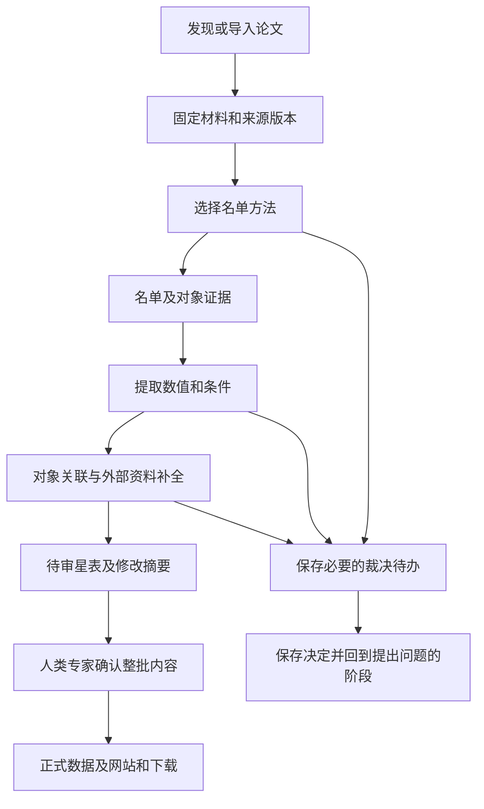

# 产品设计

本文说明总体产品设计，包括系统要做什么、为什么这样设计，以及文件准备放在哪里。目录图展示计划中的系统，当前已经可用的功能见 [README](../README.md)。

## 产品目标与科学边界

项目从高速星相关文献中整理论文提出的判断和测量值，保存出处，识别不同论文中指向同一天体的记录，并用来源明确的外部资料补充信息。最终形成的星表，应能回查每条记录的依据。

初始研究范围是文献支持的银河系非束缚候选，即可能不受银河系引力束缚的天体，以及对它们的后续实质研究。后续论文否定或修改早先判断时，也要保留这些研究结果。具体收录哪些论文和对象，由审定的科学规则和原文证据决定。

用户应能回查某篇论文研究了哪些对象、报告了什么数值及条件、证据来自哪里，同一对象在后续研究中如何被描述，以及记录为何发生更正。

论文报告的动力学、束缚状态、概率或起源研究结果，可以记录并注明来源。系统不自行开展这些物理计算，不用自己的物理模型决定是否收录，也不从多个来源中挑选“最佳物理参数”。这些限制用于避免系统自行加入额外的科学假设。

需要保存的基本信息包括：

- 哪些结果由当前论文提出，哪些引用了前人的研究，以及它们涉及的对象和上下文。
- 论文原值、单位、误差或区间、适用条件、缺失原因及原文证据；换成统一格式后，仍能对应回论文的原始表达。
- 对象的标识、别名、关联依据，以及合并、拆分和科学修订的理由。
- 外部资料的来源条目、版本或查询时间、匹配依据、观测与质量信息。

使用某份材料时，固定其版本，并把证据定位到页、表、行或段落。不能仅凭名称相同、某个标签、群体描述或阈值语句，就得出某个对象的科学结论；需要同时检查规则和原文依据。不同来源的测量，分别保存适用条件和出处。

检索到论文、成功解析表格或数据格式正确，还需要按科学规则判断是否应当收录。程序出错、提取尚未完成、论文确实没有报告某项内容，要记录为不同情况。程序执行常规检查，关键科学问题无法确定时交人类专家裁定。

### 科学规则的维护来源

具体科学规则、条件和例外集中在 `src/hvs_catalog/resources/` 下的结构化规则材料中，作为唯一维护来源。材料须便于专家阅读和审定，程序直接读取，并从同一来源自动生成阅读版。本文维护科学目标、设计理由和解释，引用具体规则；阅读版不另行手工维护规则。

规则新增或修改先交人类专家审定，说明科学目的与影响，并用容易混淆的例子核对预期结果。帮助模型完成提取的策略单独评估。规则材料与方法提示、模型配置分别管理；具体子目录、文件格式和阅读版生成方式在 R03 确定，目前尚未建立这些资源。

## 用户工作过程

官方首版在人类专家本机按需运行。独立安装者处理自己的工作空间、裁决和结果；社区通过 GitHub issue/PR 提议更正，官方入库与发布由人类专家控制。



常规处理尽可能自动完成。保存尚未解决的问题后，可以继续处理不受该问题影响的其他论文；程序重启后仍能找到问题、证据和已有决定。本地裁决网页用于处理运行中的问题，静态星表网页用于浏览正式记录。某次运行中的裁决，不自动改变通用科学规则。

首版本地裁决服务默认只允许从本机访问，暂不提供多用户后台。关闭浏览器后任务仍然保留，也能从命令行（CLI）继续处理。

静态星表网站计划提供面向新用户的“项目与数据指南”，解释 AI 如何从文献提取数据、设计原则如何影响结果，以及如何理解和使用星表。指南与来源记录、字段说明和下载入口相互连接，随网站获准发布；内容归属及维护要求见 [文档维护规范](../CONTRIBUTING.md#文档维护与防止漂移)。

已有星表可以继续新增论文和修订记录。每次生成下一版候选时，保留未受影响的记录，列明新增、修订及受影响的对象；修订前后内容和原有依据都应能够回查。

发布前，先准备具体的待发布内容及修改摘要，请人类专家确认这些内容和发布目标，再按批准范围提交、推送并更新网站和下载。首次公开与日常批次发布分别取得相应授权。开发期间的 Git 操作遵循 [维护规范](../CONTRIBUTING.md)，正式发布的详细流程在相应功能完成时补充。

## 业务架构与依赖

系统采用一个 Python 应用，按工作内容分成五个模块，共用记录格式、配置和工作空间。只有实际需要时才增加新的代码层次。

| 模块 | 负责的结果 | 主要依赖 |
|---|---|---|
| `pipeline` | 获取材料、提取名单与数值、关联对象、补充外部资料，并安排这些步骤的执行顺序 | `llm`、裁决功能、共用记录格式、配置和工作空间 |
| `llm` | 解析模型配置、组合提示、调用接口、保存响应和用量 | 配置、方法提供的提示和运行记录 |
| `review` | 展示证据与待办，保存决定和案例，提供命令行及网页操作 | 共用记录格式和工作空间；通过统一的运行入口恢复任务 |
| `catalog` | 准备待审星表、导出数据、生成网站和执行获准发布 | 经检查的工作结果、正式记录及发布状态 |
| `evaluation` | 固定实验输入与配置、调用提取功能、生成评分报告，并提供 Gold 工具 | `pipeline` 对外提供的提取接口；获准使用的私有答案 |

共用的基础模块不依赖这五个模块的内部代码。裁决模块向提取流程、网页和 CLI 提供创建和查询待办、保存决定的共同接口；流程执行部分负责恢复对应任务。页面模板只负责展示，不负责科学判断或写入数据库。流程图安排步骤顺序，具体提取和检查由对应模块完成。执行顺序与重复操作的处理见 [保存、恢复与版本](#保存恢复与版本)。

日常提取与评测（benchmark）调用同一个提取接口。提取完成后，评分程序单独读取 Gold；提取程序不接收答案、Gold 路径或逐项评分数据。产品有文献处理、Gold 标注和评测三类任务。

方法与步骤统一在代码中登记，命令行根据实际实现展示可用功能。Gold 保存和评分等顺序任务可以使用普通函数。

### 名单方法和模型选择

首版有两种名单提取方法：`direct` 直接按规则提取对象；`candidate_review` 先寻找候选对象，再由模型逐项判断。两种方法输出相同的名单格式，随后使用同一套数值提取功能。

候选方法保存纳入、排除或尚未确定的理由。寻找候选和逐项判断时，都能查看对应原材料。没有发现的对象不会进入后续判断，因此要单独评价候选是否找全。

科学规则决定应当提取什么，方法决定步骤和必要提示，模型配置决定使用哪个模型、模式和参数。可以为整个流程设置默认模型，也可以为某一步单独指定完整模型配置。模型补充提示可以调整表达方式，但必须保留方法要求的科学内容和输出格式。

连接地址、凭据读取、超时、重试、并发与限速属于运行配置；试验配置放在工作空间。资源的发行范围见 [内容进入哪里](#内容进入哪里)。

每种方法列出允许单独指定模型的步骤。给不存在或未启用的步骤设置模型时，运行前报错。关闭模型补充提示后，任务说明、科学规则和输出要求仍须完整保留。不同协议的参数不能混用，也不能根据评测论文 ID 预先写入答案。方法和模型如何组合，应通过固定其他输入的实验来比较；不能只看模型名称就自动决定提取方法。

根据实际服务接口、模型模式和调用方式，核对支持哪些参数，不给所有模型强制设置同样的采样参数。记录实际发送和省略的参数，以及默认值或参数转换的依据；服务端未公开的值标为未知。即使请求中指定了输出格式，也要检查实际结果。输出截断、内容为空和技术失败分别处理，不能擅自套用另一模型的参数或更换模型。

### 技术选择与责任

| 技术 | 采用理由与职责 |
|---|---|
| Python、uv 和锁文件 | 统一开发语言、依赖和安装方式 |
| LangGraph | 安排流程、暂停与恢复；科学规则和可靠写入由应用负责 |
| SQLite | 本机保存业务数据；恢复与备份要求见下文 |
| Pydantic | 定义和检查记录格式，并生成格式说明 |
| FastAPI/Jinja2 | 提供本地裁决网页，与命令行共用业务功能 |
| Astroquery | 查询审定的天文数据库并保留出处 |
| 静态 HTML/CSS/JavaScript | 根据固定数据版本生成网站和下载入口 |

LangGraph 的定位见[官方概览](https://docs.langchain.com/oss/python/langgraph/overview)，中断与重入行为见[官方中断说明](https://docs.langchain.com/oss/python/langgraph/interrupts)。依赖在实际引入时锁定，技术采用以当前实现的实际验证为依据。

## 目录与文件职责

本节说明模块和资料放在哪里、哪些内容进入发行包。代码布局保留到模块层级，内部文件在实施时细化；调整后同步相关说明。

### 主仓目标布局

```text
hvs-catalog/
├── README.md、AGENTS.md、CONTRIBUTING.md
├── pyproject.toml、uv.lock      # 包定义、依赖与版本
├── src/hvs_catalog/
│   ├── pipeline/               # 文献处理
│   ├── llm/                    # 模型调用
│   ├── review/                 # 裁决与案例
│   ├── catalog/                # 星表生成与发布代码
│   ├── evaluation/             # 评测和 Gold 工具
│   └── resources/              # 科学规则、提示和模型配置
├── catalog/                    # 正式数据：论文、对象及版本清单
├── contracts/generated/        # 从代码生成的数据格式说明
├── tests/                      # 测试与可公开样例
├── tools/                      # 开发检查工具
├── docs/                       # 设计、指南内容和操作说明
├── .github/                    # 自动检查与获准发布配置
├── .dev/                       # 开发计划与进度
│   ├── plan.md
│   └── progress.md
└── .work/                      # 默认运行工作空间
```

根目录的 `catalog/` 保存正式数据，源码中的同名目录保存处理程序。产品文档、测试、开发材料和运行结果各自存放，发行范围见下方“内容进入哪里”。

### 代码内部布局

五个模块的职责与调用关系见 [业务架构与依赖](#业务架构与依赖)。内部组织按 [开发工作约定](../CONTRIBUTING.md#开发工作约定) 调整。

数据格式由代码定义并生成说明，本文的 [记录职责](#记录职责) 解释各类记录负责保存什么。科学规则的维护方式见 [科学规则的维护来源](#科学规则的维护来源)。

### Gold 仓目标布局

Gold 仓的具体目录与使用要求统一见 [Gold README](../../hvs-catalog-gold/README.md#资料结构与使用约定)，工具由主仓提供。

### 运行工作空间布局

工作空间默认放在主仓 `.work/`，也允许使用者指定到仓库外。按运行需要创建以下内容，具体配置和数据库文件名在实施时确定。

| 内容 | 用途 |
|---|---|
| 运行配置、业务数据库和框架检查点 | 连接设置、实际结果与流程进度 |
| 来源材料 | 固定版本的论文及解析结果 |
| 运行与实验材料 | 请求、结果、配置、费用和诊断 |
| 发布候选 | 待审核数据、网站和下载文件 |
| 备份 | 能一起恢复的材料、业务记录和执行进度 |

演示空间与日常空间分开。Gold、最终评价预留材料和含答案分析的存放要求见下表；被 Git 忽略的必要运行材料仍须保留。

### 内容进入哪里

| 内容 | Git | 代码发行包 | 维护来源 |
|---|---|---|---|
| 程序、规则、必要提示、稳定配置与界面资源 | 主仓 | 按运行需要包含 | 源码与已确定且可公开的资源定义 |
| 正式星表 | 主仓 | 排除，独立提供数据下载 | 获准发布的具体内容 |
| 产品文档及通用规范 | 主仓 | 不作为运行依赖 | 对应文档正文 |
| 核心重构计划、进度与当前交接 | 主仓只纳入这两份文件 | 排除 | `.dev/plan.md` 与 `.dev/progress.md` |
| 本机开发材料、凭据、环境、缓存和运行产物 | 忽略 | 排除 | 本机或运行空间 |
| 正式 Gold、材料清单、审定及来源记录 | Gold 私库 | 排除 | 私库正式记录 |
| Gold 草稿、最终评价预留材料与逐项评分 | 不进入 Git | 排除 | 私有工作空间 |

两仓的 `.gitignore` 落实上述范围；主仓 `.dev/` 只纳入计划和进度，Gold 仓忽略整个 `.dev/`。安装包的实际范围由构建配置定义，并检查构建产物。

完整克隆 Git 仓库时，会同时下载纳入版本管理的正式数据。只安装程序时，使用代码发行包。初始化空白工作空间与导入已有正式数据是两个操作，只有用户明确要求时才导入数据。

## 记录职责

具体字段和允许取值在科学审定后确定。“内容哈希”是根据文件内容计算的标识，用于检查内容是否变化。

| 记录 | 负责保存什么 |
|---|---|
| 论文与来源包 | 论文标识、材料版本和原文位置 |
| 论文贡献 | 对象、论文提出的判断与测量、条件和证据 |
| 名单结果 | 对象角色、方法、证据及完成或未决状态 |
| 对象与外部记录 | 稳定身份、别名、关联依据及有出处的外部资料 |
| 裁决 | 问题、决定、理由、操作者和适用的材料与规则版本 |
| 运行清单 | 实际输入、规则、方法、模型、提示、代码与依赖版本、案例、结果和用量 |
| 发布清单 | 数据版本、内容哈希、来源运行与代码、修改摘要、批准及各渠道结果 |

论文记录保存该论文的元数据和贡献；对象记录通过引用关联论文测量，避免同一内容在两处分别修改。对象改名不改变稳定身份；合并、拆分及科学更正保留理由和依据。

## 保存、恢复与版本

每次运行都固定来源材料、规则、代码和依赖的版本，以及方法、各步骤模型、实际提示、配置和所用案例。操作标识和缓存判断须包含这些会影响结果的输入。恢复时使用原来保存的输入；输入改变后，记录为一次新的执行，避免错误复用旧结果。按步骤和模型记录用量，汇总整次费用；无法确定的用量或费用标为未知，记录中不保存凭据值。

业务数据库保存实际结果和裁决决定，框架检查点保存流程执行到哪里。先把结果和裁决决定保存到磁盘，再请求恢复；重启后根据已保存记录核对状态。无论从命令行还是网页启动，同一工作空间中的同一任务，同时只能有一个执行者。备份须让材料引用、业务记录和检查点保持对应，恢复后能够检查它们是否一致。

恢复流程时，框架可能再次执行某个步骤。输入相同时，复用已经可靠保存的结果；相同决定重复提交只生效一次，冲突或基于过期材料、规则的决定明确拒绝。如果收到远程服务响应后、保存前发生故障，恢复时可能再次调用服务。因此，外部调用仍可能重复发生。

软件版本只在 `pyproject.toml` 中定义，运行时从已安装包的信息中读取。记录格式、科学规则和正式数据分别有自己的版本，运行或发布清单记录使用了哪些版本。运行 ID 和方法名称不用于另行定义软件版本。

## 评价、Gold 与持续改进

在获准范围内核对 Gold 的正式版本和科学依据。首次迁移时，先说明新旧字段怎样对应、是否保留原有科学含义，再逐项审定规则变化或已有疑点引起的科学修改。格式转换成功后，仍须完成科学审定，并取得对具体保存内容的批准。

新 Gold 由获准的标注者根据原文制作草稿，提交人类专家审定。产品提供接收草稿、检查格式与必要来源信息、保存获准内容的工具；新草稿无需提供旧答案或迁移记录。检查通过后仍须取得对具体内容的科学审定和保存批准。新标注与迁移草稿共用检查和保存工具。

实验前固定 [运行输入](#保存恢复与版本)，并记录数据格式、Gold、来源版本、各步骤模型参数、轮次、并发数、重试上限、指标、预算和停止条件。科学通过条件经人类专家审核后固定，不能看到结果后再修改条件来取得通过。

分别报告处理完成的论文、名单精确率和召回率、候选是否找全、从名单到数值的整体正确性、证据是否对应、失败、部分结果及尚未确定的情况、多次运行是否稳定、实际费用和专家用时。数值评价使用预定的严格要求，不能只看成功提取的字段。

空预测、整篇失败和部分结果，都按事先规定计入分母，不能为了提高分数而删去；用手算样例核对评分。分别展示自动结果和人工裁决后的结果。更换 Gold 或科学目标后，明确说明新的评价目标。

实验失败时保留必要原始结果与失败轮次，在同一评价目标下修复并复验。报告注明是重新处理已有结果、假设改变条件的分析，还是实际调用服务的新实验。最终评价输入固定后，运行代码、规则、方法、提示、依赖或案例变化须重验受影响部分；只整理说明文字时，不重复无关的付费实验。

已用于开发的论文用于检查修改后是否仍能正确处理，即使经过迁移也不能当作独立测试材料。前期另选少量未用于开发的论文，单独保存并限制访问，留作最终评价；后期按审定规则进行标注和裁定。标注者不查看待测系统的预测。若根据评价结果继续调参，须注明这些材料已经参与开发。小样本得到的结论只适用于实际测试过的范围。

首版支持保存案例、检查适用条件、复用及汇总。相似案例可以参考，复用时引用原决定，不能记成专家又批准了一次。每次实验固定使用一份案例，日常运行新增的案例不自动加入当前实验。后续改进使用哪些开发工具和模型，由人类专家安排。

## 文档的职责与引用

当前可用能力见 [README](../README.md)，文档分工与维护规则见 [CONTRIBUTING](../CONTRIBUTING.md#文档维护与防止漂移)。开发任务从 [AGENTS](../AGENTS.md) 进入。
