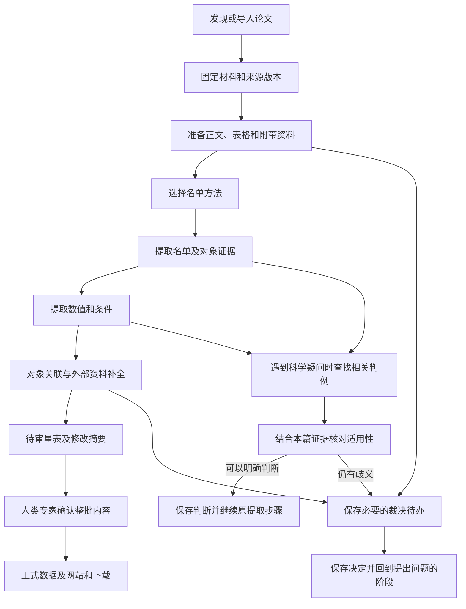

# 产品设计

本文说明总体产品设计，包括系统要做什么、为什么这样设计，以及文件准备放在哪里。目录图展示计划中的系统，当前已经可用的功能见 [README](../README.md)。

## 产品目标与科学边界

项目从高速星相关文献中整理论文提出的判断和测量值，保存出处，识别不同论文中指向同一天体的记录，并用来源明确的外部资料补充信息。最终形成的星表，应能回查每条记录的依据。

初始研究范围是文献支持的银河系非束缚候选，即可能不受银河系引力束缚的天体，以及对它们的后续实质研究。后续论文否定或修改早先判断时，也要保留这些研究结果。具体收录哪些论文和对象，由审定的科学规则和原文证据决定。

用户应能回查某篇论文研究了哪些对象、报告了什么数值及条件、证据来自哪里，同一对象在后续研究中如何被描述，以及记录为何发生更正。

论文报告的动力学、束缚状态、概率或起源研究结果，可以记录并注明来源。系统不自行开展这些物理计算，不用自己的物理模型决定是否收录，也不从多个来源中挑选“最佳物理参数”。这些限制用于避免系统自行加入额外的科学假设。

需要保存的基本信息包括：

- 哪些结果由当前论文提出，哪些引用了前人的研究，以及它们涉及的对象和上下文。
- 论文原值、单位、误差或区间、适用条件、缺失原因及原文证据；换成统一格式后，仍能对应回论文的原始表达。
- 对象的标识、别名、关联依据，以及合并、拆分和科学修订的理由。
- 外部资料的来源条目、版本或查询时间、匹配依据、观测与质量信息。

首版论文提取只依据固定版本的 arXiv LaTeX 源码资料包，包括其中的正文、附录、表格及随包提供的附带资料。论文链接的包外资源暂不获取或处理；引用的其他论文或独立数据库不因被提及而成为本篇材料。期刊正式版与 PDF 提取留待后续扩展。跨论文对象关联与外部资料补全在本篇提取完成后进行。

包内能够确认的结果照常提取；需要包外资源或当前无法解析的材料才能确定的部分，记录未处理范围及原文位置，不记成“论文未报告”或科学排除。缺口影响对象收录或身份时，相应判断保持未完成。没有可处理的 LaTeX 源码包时，记录材料不可用，保留以后补处理的入口。

使用某份材料时，固定其版本，并把证据定位到页、表、行或段落。不能仅凭名称相同、某个标签、群体描述或阈值语句，就得出某个对象的科学结论；需要同时检查规则和原文依据。不同来源的测量，分别保存适用条件和出处。

检索到论文、成功解析表格或数据格式正确，还需要按科学规则判断是否应当收录。程序出错、提取尚未完成、论文确实没有报告某项内容，要记录为不同情况。

### 科学规则的维护来源

文献提取规则以 [英文 TOML](../src/hvs_catalog/resources/science/rules.toml) 为唯一来源，[英文阅读版](science-rules.md) 从中生成。收录资格、贡献类型、作者状态、物理量范围、数值处理与科学疑问的具体要求均由规则定义。实际提示读取同一来源，完整阅读版不等于每次调用的完整提示。

提取者接收已准备的本篇材料及本次可用判例，完成原文判断、对象与数值提取、证据记录和疑问提交。材料获取与准备、版本管理、裁决恢复、判例制作及提取后的关联和维护，由 [用户工作过程](#用户工作过程) 与 [专家裁决与判例](#专家裁决与判例) 规定。规则与方法提示、模型配置分别管理，维护信息不发送给提取者。

规则变更的科学审定、旧规则对应和生成操作见 [科学规则维护](../CONTRIBUTING.md#科学规则维护)。

### 旧规则对照与调整

当前作者状态相对旧规则增加“可能束缚”，并将 `not_assessed` 与 `no_overall_conclusion` 合并为“无总体结论”。迁移旧结果时，含义发生变化的记录须对照原文重新核对，不能只批量替换状态名称。旧规则及数值字段的对应保存在规则来源的维护信息中。

### 审阅语言与发布语言

提供给提取者的规则、任务与方法提示、模型补充提示、填写模板、字段说明、合成例子和判例统一使用英文。字段名、状态编码和新写的研究摘要、疑问及判例说明也使用英文。论文材料、原文证据、对象名称和原始数值按来源保留。回传提取者的专家决定提供与原决定一致的英文内容，同时保留原决定。

首版不提供运行时语言选择。实际发送的文本按 [保存要求](#保存恢复与版本) 固定，科学效果按 [英文输入评价](#英文输入的核对与评价) 检查；统一语言本身不构成效果提升的证据。专家文档语言、临时中文解释与发布前翻译见 [审阅与发布语言维护](../CONTRIBUTING.md#审阅与发布语言维护)。

## 用户工作过程

官方首版在人类专家本机按需运行。独立安装者处理自己的工作空间、裁决和结果；社区通过 GitHub issue/PR 提议更正，官方入库与发布由人类专家控制。

### 文献检索与材料获取

每轮检索的时间范围、检索词、类别及指定论文由人类专家决定，程序保存实际条件、查询时间、返回结果与处理进度。首版支持专家隔一段时间启动一轮运行，在所选范围内发现论文；是否补查历史文献及运行间隔也由专家决定。

文献发现与获取仅使用 arXiv 服务：通过 [arXiv API](https://info.arxiv.org/help/api/user-manual.html) 检索和读取元数据，再从 arXiv 的 [源码下载入口](https://info.arxiv.org/help/view.html#other-formats) 获取具体版本的 LaTeX 资料包。文献处理无需 DeepXiv。也可导入已下载的同类源码包，保留其 arXiv 标识、版本和来源。已有期刊引用或 DOI 可保存为元数据，提取依据仍为固定的 arXiv 版本。包内附带资料的范围见 [科学边界](#产品目标与科学边界)，arXiv 的 [附带文件说明](https://info.arxiv.org/help/ancillary_files.html) 说明这些文件随具体论文版本保存。

首次获取论文时，默认采用当时最新的 arXiv 版本，并固定具体版本号及源码包。后续每轮除检索新论文外，也检查已收录论文是否有新版；旧论文的首次提交日期不在本轮新文献检索范围内，也须检查其修订。已开始的处理继续使用原来固定的版本。

发现新版后，作为同一论文的修订重新处理，比较与旧版的变化，按下述星表维护流程准备修订。不同版本不作为独立论文重复加入星表。旧版材料、提取结果和变化记录均保留；新版获取或处理失败不覆盖旧结果。

版本选择、检查新版和比较修订由系统在提取任务之外完成。每次提取只提供选定版本的材料，不要求提取 AI 选择、下载、合并或管理多个 arXiv 版本。

每轮检查所选检索范围的分页与完成情况。限流、下载失败或未处理完的分页保留进度，不能记成该范围已检索完成。重复命中同一论文与版本时合并检索记录；实际处理仍依据 [固定输入与复用要求](#保存恢复与版本) 判断，保留失败和未完成项供后续继续。检索范围改变后，按新范围记录覆盖情况。

### 提取材料的准备

程序在提取前读取选定的源码包，整理正文、表格及包内附带数据，保留原始文件和位置对应。将表格转换成便于程序读取的格式时，保留标题、表头、单位、注释、对象行及证据位置，使提取 AI 能结合原文理解数值。转换后的内容是同一来源的另一种呈现，不能计为新增科学结果；与原文不一致时以原文为依据，并记录解析问题供修复。转换、解析和修复属于材料准备，提取 AI 负责核对所读内容与原文并报告问题。

“星 1–5”等编号范围由确定性程序在含义明确、能够正确解析时展开，并保留原写法、出处和展开结果的对应关系，供提取 AI 核对。程序不支持的写法保留原文和未列清的范围，留待修复；缺少材料时保持未完成；原文含义本身有歧义时交专家判断。不能让模型猜补成员，也不能把解析失败当成没有对象。

程序记录材料获取与解析的完成情况，把已知缺口随材料一起交给提取 AI。AI 报告提取中发现的问题和受影响的内容；系统汇总技术失败与未完成状态，安排后续处理。可确认的部分继续保留，依赖缺失材料的结果不能记成已经完成。

### 跨论文对象关联

本篇提取完成后，由确定性程序读取已经提取并确认的对象标识、原文对应关系和已保存的裁决决定，按本节条件执行关联。程序无法确认或发现相反证据时，保存候选关系交专家判断；专家决定保存后，程序据此继续执行。这里的条件用于实现和检查关联程序，文献提取规则不负责执行这一阶段。

同一目录、同一版本的明确对象标识一致，或论文明确给出跨论文的同一对象对应关系，且没有相反证据时，可以自动关联。仅坐标接近、名称相似或别名关系含糊时，保存候选关联交专家确认；存在相反证据时也交专家处理。

关联保留标识或原文等依据，各篇论文的原始记录和证据分别保存。不同目录版本中的相同编号不满足上述标识一致条件；未确定的候选关联保持未决。

### 外部资料补全

首版在论文提取完成后，由确定性程序通过 Astroquery 查询以下来源，并按审定的字段和保存要求处理返回资料：

| 来源 | 补充范围 |
|---|---|
| SIMBAD | 对象标识、别名及相关文献链接 |
| Gaia Archive | 星表报告的位置、视差、自行、径向速度，以及相应误差和质量信息 |

保存查询条件、返回条目、来源、可取得的目录版本和查询时间；身份匹配确认后，将外部记录与论文记录并列关联到对象，保留匹配依据。匹配不确定时保留候选关联和待决状态。外部资料独立保存，论文原始记录和科学结论继续以本篇材料为依据。

接口参考 [Astroquery SIMBAD 文档](https://astroquery.readthedocs.io/en/latest/simbad/simbad.html) 与 [Astroquery Gaia 文档](https://astroquery.readthedocs.io/en/latest/gaia/gaia.html)。具体目录版本、字段映射和查询范围在相应功能实施前核定，真实服务调用按 [操作授权](../CONTRIBUTING.md#开发工作约定) 执行。

### 单轮处理与星表维护



上图展示默认启用专家裁决的流程，运行配置见 [专家裁决开关](#专家裁决开关)。常规处理尽可能自动完成。保存尚未解决的问题后，可以继续处理不受该问题影响的其他论文；程序重启后仍能找到问题、证据和已有决定。本地裁决网页用于处理运行中的问题，静态星表网页用于浏览正式记录。某次运行中的裁决，不自动改变通用科学规则。

首版本地裁决服务默认只允许从本机访问，暂不提供多用户后台。关闭浏览器后任务仍然保留，也能从命令行（CLI）继续处理。

静态星表网站计划提供面向新用户的“项目与数据指南”，解释 AI 如何从文献提取数据、设计原则如何影响结果，以及如何理解和使用星表。指南与来源记录、字段说明和下载入口相互连接，随网站获准发布；内容归属及维护要求见 [文档维护规范](../CONTRIBUTING.md#文档维护与防止漂移)。

每轮运行在已有星表上整理新贡献，生成下一版待审星表和修改摘要，经专家确认后纳入正式星表。重复运行或检索时间重叠时，同一贡献不重复加入；未完成的论文和裁决继续保留。已有星表也支持修订记录：保留未受影响的记录，列明新增、修订及受影响的对象，修订前后内容和原有依据均可回查。

发布前，先准备具体的待发布内容及修改摘要，请人类专家确认这些内容和发布目标，再按批准范围提交、推送并更新网站和下载。首次公开与日常批次发布分别取得相应授权。开发期间的 Git 操作遵循 [维护规范](../CONTRIBUTING.md)，正式发布的详细流程在相应功能完成时补充。

## 专家裁决与判例

### 自动判断与专家裁决

日常运行按提取规则 [S03–S04](science-rules.md#s03-check-the-inclusion-evidence-and-contribution-type) 和 [S07](science-rules.md#s07-check-completeness-and-handle-unresolved-questions) 处理收录、作者判断和科学疑问。材料齐全，原文含义、对象归属和规则适用均明确时，由提取者直接处理；参考判例后仍需揣摩作者倾向或权衡相互矛盾的表述时，交人类专家裁定。纯 AI 对照实验的处理方式见 [专家裁决开关](#专家裁决开关)。

系统分别保存论文的作者状态和任务的处理进度。“无总体结论”是作者状态；提取者无法确定原文意思时保存待裁决，材料缺失或解析失败时保存未完成。待决对象不能自动排除。提交裁决时，附相关原文、条件和已提取的数值，简短说明疑问，无需先猜出结论。

按 [S06](science-rules.md#s06-check-object-assignments-duplicates-and-conflicting-values) 保留数值冲突及其证据。专家仍无法消除冲突时，受影响的测量保持冲突未决；只要对象收录和身份不受影响，其他已确认结果可继续进入关联和星表整理。

### 专家裁决开关

日常运行与评测共用的提取入口提供“是否启用运行中专家裁决”的配置，默认开启，两种名单方法及共同的后续步骤都使用该配置。发现科学疑问、保存证据和处理结果共用原有流程；是否请求专家由统一入口处理，避免维护两套提取流程。裁决开关与名单方法、模型选择分别设置。

开启时，按科学规则提交歧义并通过裁决接口恢复。关闭时，不请求或等待本轮专家裁决，发现的疑问及其处理结果仍须保存。开关控制运行中的个案裁决，Gold 审定、正式星表保存和发布的授权仍按各自流程执行。

纯 AI 对照实验允许模型依据相同论文材料和科学规则，尝试处理日常流程中通常交给专家的解释歧义；仍无法判断时保留未决，不强制给出结论。这一例外仅适用于纯 AI 实验组，提取范围、作者原值和原文证据等要求照常适用；材料缺失或技术失败仍记录为未完成。模型作出的判断按该实验组的模型结果保存，不能记作专家裁决或直接进入已审定判例库。

日常提取指令只说明遇到歧义时提交专家。系统在获准的纯 AI 实验中单独提供相应的歧义处理说明，明确替换这一处理要求，其余科学要求保持相同。实验切换、两组结果隔离与固定判例由程序负责，不把整套实验安排写入日常提取规则。

配置由程序记入运行清单，并参与保存、恢复和结果复用的检查。两组结果分别保存，关闭组不能使用开启组在本轮新增的专家决定或据此产生的结果。改变配置后建立新的执行，不能在原运行中悄悄改变裁决方式。对照方法见 [专家裁决的对照实验](#专家裁决的对照实验)。

### 判例的录入与复用

判例解释主规则的适用方式，不改变主规则。专家核对其与主规则一致后，才纳入可复用库。冲突或一致性尚不能确认的内容不能入库；规则需要调整时按 [科学规则维护](../CONTRIBUTING.md#科学规则维护) 单独审定。

专家保存个案决定后，原任务按该决定恢复。模型另行依据原文证据和已保存的决定起草简短英文判例，保留可复用的理由、适用条件、必要边界及原裁决关联。起草失败、等待审核或未获通过均不阻塞原任务恢复，草稿不可复用。

提取者遇到不能直接依据规则解决的科学疑问时，流程按需查找判例，再让提取者结合本篇证据核对适用性；明确的问题直接处理。查找可先按关联规则和问题类别筛选，只提供少量相关的已审定英文判例。配置同时限制数量和总长度；超出篇幅时减少所选判例，保留每个判例必要的理由、适用条件和边界。

相似判例须经适用性核对，本篇事实和数值仍由本篇材料支持。没有相关判例或仍有歧义时，按 [裁决配置](#专家裁决开关) 处理，日常流程交专家，不能据此排除对象。查找失败保留技术失败信息，不能当成没有适用判例或据此作科学结论。

程序保存本次查找及实际提供的判例、版本和文本，恢复使用固定内容；未选中的库内变化不改变当前执行。提取者的简短复用说明遵循 [S07](science-rules.md#s07-check-completeness-and-handle-unresolved-questions)，版本由程序统一记录，无需逐项填写。复用关联原决定，不能记成专家本次又批准了一次；本次裁决按 [记录职责](#记录职责) 保存。

程序支持汇总重复问题、待办与专家用时。每次实验固定判例快照，日常新增判例不自动加入当前实验，具体要求见 [专家裁决的对照实验](#专家裁决的对照实验)。后续改进使用哪些开发工具和模型，由人类专家安排。

## 业务架构与依赖

系统采用一个 Python 应用，按工作内容分成五个模块，共用记录格式、配置和工作空间。只有实际需要时才增加新的代码层次。

| 模块 | 负责的结果 | 主要依赖 |
|---|---|---|
| `pipeline` | 获取材料、提取名单与数值、关联对象、补充外部资料，并安排这些步骤的执行顺序 | `llm`、裁决功能、共用记录格式、配置和工作空间 |
| `llm` | 解析模型配置、组合提示、调用接口、保存响应和用量 | 配置、方法提供的提示和运行记录 |
| `review` | 展示证据与待办，保存决定和案例，提供命令行及网页操作 | 共用记录格式和工作空间；通过统一的运行入口恢复任务 |
| `catalog` | 准备待审星表、导出数据、生成网站和执行获准发布 | 经检查的工作结果、正式记录及发布状态 |
| `evaluation` | 固定实验输入与配置、调用提取功能、生成评分报告，并提供 Gold 工具 | `pipeline` 对外提供的提取接口；获准使用的私有答案 |

共用的基础模块不依赖这五个模块的内部代码。裁决模块向提取流程、网页和 CLI 提供创建和查询待办、保存决定的共同接口；流程执行部分负责恢复对应任务。页面模板只负责展示，不负责科学判断或写入数据库。流程图安排步骤顺序，具体提取和检查由对应模块完成。执行顺序与重复操作的处理见 [保存、恢复与版本](#保存恢复与版本)。

日常提取与评测（benchmark）调用同一个提取接口。提取完成后，评分程序单独读取 Gold；提取程序不接收答案、Gold 路径或逐项评分数据。产品有文献处理、Gold 标注和评测三类任务。

方法与步骤统一在代码中登记，命令行根据实际实现展示可用功能。Gold 保存和评分等顺序任务可以使用普通函数。

### 名单方法和模型选择

首版有两种名单提取方法：`direct` 直接按规则提取对象；`candidate_review` 先寻找候选对象，再由模型逐项判断。两种方法输出相同的名单格式，随后使用同一套数值提取功能。

候选方法保存每个候选的纳入、排除或未决结果及原文证据，额外说明按 [判例记录要求](#判例的录入与复用) 提供。寻找候选和逐项判断时，都能查看对应原材料。没有发现的对象不会进入后续判断，因此要单独评价候选是否找全。

科学规则决定应当提取什么，方法决定步骤和必要提示，模型配置决定使用哪个模型、模式和参数。可以为整个流程设置默认模型，也可以为某一步单独指定完整模型配置。模型补充提示可以调整表达方式，但必须保留方法要求的科学内容和输出格式。

连接地址、凭据读取、超时、重试、并发与限速属于运行配置；试验配置放在工作空间。资源的发行范围见 [内容进入哪里](#内容进入哪里)。

每种方法列出允许单独指定模型的步骤。给不存在或未启用的步骤设置模型时，运行前报错。关闭模型补充提示后，任务说明、科学规则和输出要求仍须完整保留。不同协议的参数不能混用，也不能根据评测论文 ID 预先写入答案。方法和模型如何组合，应通过固定其他输入的实验来比较；不能只看模型名称就自动决定提取方法。

根据实际服务接口、模型模式和调用方式，核对支持哪些参数，不给所有模型强制设置同样的采样参数。记录实际发送和省略的参数，以及默认值或参数转换的依据；服务端未公开的值标为未知。即使请求中指定了输出格式，也要检查实际结果。输出截断、内容为空和技术失败分别处理，不能擅自套用另一模型的参数或更换模型。

### 提示的组装与例子选用

一次提取可包含名单提取、候选判断和数值提取等步骤。每次调用组合当前步骤的任务说明、科学规则及所需定义、方法提示、填写格式、选用的合成例子，以及本篇材料和必要的已有结果。判例按 [查找与复用流程](#判例的录入与复用) 提供。方法和模型补充提示不能修改科学规则，关闭补充提示后科学要求及填写格式仍须完整。

填写格式依据共同的数据定义生成，说明字段、允许取值、多个结果及缺失或未决的表示；只要求提取者填写当前步骤的科学结果，运行信息由程序记录。

合成例子用于专家核对规则预期、后续程序检查及必要的模型示范。按当前步骤选用相关例子：名单阶段主要解释收录、贡献类型和作者判断，数值阶段主要解释物理量、条件、误差、重复与冲突；共同适用的例子可以在多个步骤使用。选择由已确定的步骤配置完成，不要求提取模型自行从例子全集中挑选，也不默认每次发送全部例子。记录实际选用的编号与文本，并检查选例没有遗漏当前步骤需要遵守的科学要求。

合成例子与已审定判例分别标明用途，都不能替代本篇原文证据。能够重现提示中已有例子的答案，不能作为真实论文提取质量的独立证据。提示的实际效果在后续获准实验中检查。

### 技术选择与责任

| 技术 | 采用理由与职责 |
|---|---|
| Python、uv 和锁文件 | 统一开发语言、依赖和安装方式 |
| arXiv API 与源码下载 | 获取专家指定范围的文献元数据和 LaTeX 源码包 |
| LangGraph | 安排流程、暂停与恢复；科学规则和可靠写入由应用负责 |
| SQLite | 本机保存业务数据；恢复与备份要求见下文 |
| Pydantic | 定义和检查记录格式，并生成格式说明 |
| FastAPI/Jinja2 | 提供本地裁决网页，与命令行共用业务功能 |
| Astroquery | 查询审定的天文数据库并保留出处 |
| 静态 HTML/CSS/JavaScript | 根据固定数据版本生成网站和下载入口 |

LangGraph 的定位见[官方概览](https://docs.langchain.com/oss/python/langgraph/overview)，中断与重入行为见[官方中断说明](https://docs.langchain.com/oss/python/langgraph/interrupts)。依赖在实际引入时锁定，技术采用以当前实现的实际验证为依据。

## 目录与文件职责

本节说明模块和资料放在哪里、哪些内容进入发行包。代码布局保留到模块层级，内部文件在实施时细化；调整后同步相关说明。

### 主仓目标布局

```text
hvs-catalog/
├── README.md、AGENTS.md、CONTRIBUTING.md
├── pyproject.toml、uv.lock      # 包定义、依赖与版本
├── src/hvs_catalog/
│   ├── pipeline/               # 文献处理
│   ├── llm/                    # 模型调用
│   ├── review/                 # 裁决与案例
│   ├── catalog/                # 星表生成与发布代码
│   ├── evaluation/             # 评测和 Gold 工具
│   └── resources/              # 科学规则、提示和模型配置
├── catalog/                    # 正式数据：论文、对象及版本清单
├── contracts/generated/        # 从代码生成的数据格式说明
├── tests/                      # 测试与可公开样例
├── tools/                      # 开发检查工具
├── docs/                       # 设计、指南内容和操作说明
├── .github/                    # 自动检查与获准发布配置
├── .dev/                       # 开发计划与进度
│   ├── plan.md
│   └── progress.md
└── .work/                      # 默认运行工作空间
```

根目录的 `catalog/` 保存正式数据，源码中的同名目录保存处理程序。产品文档、测试、开发材料和运行结果各自存放，发行范围见下方“内容进入哪里”。

### 代码内部布局

五个模块的职责与调用关系见 [业务架构与依赖](#业务架构与依赖)。内部组织按 [开发工作约定](../CONTRIBUTING.md#开发工作约定) 调整。

数据格式由代码定义并生成说明，本文的 [记录职责](#记录职责) 解释各类记录负责保存什么。科学规则的输入来源见 [科学规则的维护来源](#科学规则的维护来源)。

### Gold 仓目标布局

Gold 仓的具体目录与使用要求统一见 [Gold README](../../hvs-catalog-gold/README.md#资料结构与使用约定)，工具由主仓提供。

### 运行工作空间布局

工作空间默认放在主仓 `.work/`，也允许使用者指定到仓库外。按运行需要创建以下内容，具体配置和数据库文件名在实施时确定。

| 内容 | 用途 |
|---|---|
| 运行配置、业务数据库和框架检查点 | 连接设置、实际结果与流程进度 |
| 来源材料 | 固定版本的论文及解析结果 |
| 运行与实验材料 | 请求、结果、配置、费用和诊断 |
| 发布候选 | 待审核数据、网站和下载文件 |
| 备份 | 能一起恢复的材料、业务记录和执行进度 |

演示空间与日常空间分开。Gold、最终评价预留材料和含答案分析的存放要求见下表；被 Git 忽略的必要运行材料仍须保留。

### 内容进入哪里

| 内容 | Git | 代码发行包 | 维护来源 |
|---|---|---|---|
| 程序、规则、必要提示、稳定配置与界面资源 | 主仓 | 按运行需要包含 | 源码与已确定且可公开的资源定义 |
| 正式星表 | 主仓 | 排除，独立提供数据下载 | 获准发布的具体内容 |
| 产品文档及通用规范 | 主仓 | 不作为运行依赖 | 对应文档正文 |
| 核心重构计划、进度与当前交接 | 主仓只纳入这两份文件 | 排除 | `.dev/plan.md` 与 `.dev/progress.md` |
| 本机开发材料、凭据、环境、缓存和运行产物 | 忽略 | 排除 | 本机或运行空间 |
| 正式 Gold、材料清单、审定及来源记录 | Gold 私库 | 排除 | 私库正式记录 |
| Gold 草稿、最终评价预留材料与逐项评分 | 不进入 Git | 排除 | 私有工作空间 |

两仓的 `.gitignore` 落实上述范围；主仓 `.dev/` 只纳入计划和进度，Gold 仓忽略整个 `.dev/`。安装包的实际范围由构建配置定义，并检查构建产物。

完整克隆 Git 仓库时，会同时下载纳入版本管理的正式数据。只安装程序时，使用代码发行包。初始化空白工作空间与导入已有正式数据是两个操作，只有用户明确要求时才导入数据。

## 记录职责

具体字段和允许取值在科学审定后确定。“内容哈希”是根据文件内容计算的标识，用于检查内容是否变化。

| 记录 | 负责保存什么 |
|---|---|
| 论文与来源包 | arXiv 标识与具体版本、来源包、原文位置及未处理的材料范围 |
| 论文贡献 | 对象、本篇研究的简短摘要、贡献类型、作者总体判断、各条件下的结论与测量及原文证据 |
| 名单结果 | 对象角色、方法、证据及完成或未决状态 |
| 对象与外部记录 | 稳定身份、别名、关联依据及有出处的外部资料 |
| 裁决 | 问题、决定、理由、操作者和适用的材料与规则版本 |
| 运行清单 | 实际输入、规则、方法、模型、提示、专家裁决配置、代码与依赖版本、案例、结果和用量 |
| 发布清单 | 数据版本、内容哈希、来源运行与代码、修改摘要、批准及各渠道结果 |

论文记录保存该论文的元数据和贡献；对象记录通过引用关联论文测量，避免同一内容在两处分别修改。对象改名不改变稳定身份；合并、拆分及科学更正保留理由和依据。

## 保存、恢复与版本

每次运行都固定来源材料、规则、代码和依赖的版本，以及方法、各步骤模型、实际提示、配置和所用案例，包括是否启用运行中专家裁决及实际发送的英文规则、提示、字段说明、示例和判例。操作标识和缓存判断须包含这些会影响结果的输入。恢复时使用原来保存的输入；输入改变后，记录为一次新的执行，避免错误复用旧结果。按步骤和模型记录用量，汇总整次费用；无法确定的用量或费用标为未知，记录中不保存凭据值。

业务数据库保存实际结果和裁决决定，框架检查点保存流程执行到哪里。先把结果和裁决决定保存到磁盘，再请求恢复；重启后根据已保存记录核对状态。无论从命令行还是网页启动，同一工作空间中的同一任务，同时只能有一个执行者。备份须让材料引用、业务记录和检查点保持对应，恢复后能够检查它们是否一致。

恢复流程时，框架可能再次执行某个步骤。输入相同时，复用已经可靠保存的结果；相同决定重复提交只生效一次，冲突或基于过期材料、规则的决定明确拒绝。如果收到远程服务响应后、保存前发生故障，恢复时可能再次调用服务。因此，外部调用仍可能重复发生。

软件版本只在 `pyproject.toml` 中定义，运行时从已安装包的信息中读取。记录格式、科学规则和正式数据分别有自己的版本，运行或发布清单记录使用了哪些版本。运行 ID 和方法名称不用于另行定义软件版本。

## 评价、Gold 与持续改进

在获准范围内核对 Gold 的正式版本和科学依据。首次迁移时，先说明新旧字段怎样对应、是否保留原有科学含义，再逐项审定规则变化或已有疑点引起的科学修改。格式转换成功后，仍须完成科学审定，并取得对具体保存内容的批准。

新 Gold 由获准的标注者根据原文制作草稿，提交人类专家审定。产品提供接收草稿、检查格式与必要来源信息、保存获准内容的工具；新草稿无需提供旧答案或迁移记录。检查通过后仍须取得对具体内容的科学审定和保存批准。新标注与迁移草稿共用检查和保存工具。

实验前固定 [运行输入](#保存恢复与版本)，并记录数据格式、Gold、来源版本、各步骤模型参数、轮次、并发数、重试上限、指标、预算和停止条件。科学通过条件经人类专家审核后固定，不能看到结果后再修改条件来取得通过。

评价关注提取的忠实与完整、自动判断边界是否可靠，以及专家负担是否下降。分别报告处理完成的论文、名单精确率和召回率、候选是否找全、从名单到数值的整体正确性、证据是否对应、自动完成比例、应裁决的问题是否发现、未决数量、裁决次数和专家用时；同时报告失败、部分结果、多次运行稳定性及实际费用。数值评价使用预定的严格要求，覆盖规定物理量及其不同条件，不能只看成功提取的字段。判例效果包括是否减少重复处理同类问题。

空预测、整篇失败和部分结果，都按事先规定计入分母，不能为了提高分数而删去；用手算样例核对评分。分别展示自动结果和人工裁决后的结果。更换 Gold 或科学目标后，明确说明新的评价目标。

实验失败时保留必要原始结果与失败轮次，在同一评价目标下修复并复验。报告注明是重新处理已有结果、假设改变条件的分析，还是实际调用服务的新实验。最终评价输入固定后，运行代码、规则、方法、提示、依赖或案例变化须重验受影响部分；只整理说明文字时，不重复无关的付费实验。

已用于开发的论文用于检查修改后是否仍能正确处理，即使经过迁移也不能当作独立测试材料。前期另选少量未用于开发的论文，单独保存并限制访问，留作最终评价；后期按审定规则进行标注和裁定。标注者不查看待测系统的预测。若根据评价结果继续调参，须注明这些材料已经参与开发。小样本得到的结论只适用于实际测试过的范围。

### 专家裁决的对照实验

比较关闭与开启运行中专家裁决的结果，评价其对名单、数值、证据、完成程度及成本的影响。以相同论文版本逐篇配对，固定科学规则、提取方法、模型配置、自动提取提示及评分标准；涉及歧义处理方式的差异在实验前写明。可保存裁决前的同一份自动结果，分别建立两组的后续执行，使比较聚焦于裁决带来的变化。

比较本轮专家介入的作用时，两组使用相同的既有判例快照，也可共同使用空判例库；判例的作用另行比较。实验中新决定及由其起草的判例不加入任一组的固定判例输入。本轮没有专家参与的组若使用了既有专家判例，报告须写明这一条件。既有判例与评价论文的独立性按上述评价材料要求检查。

保留两组完整输出，分别报告质量、覆盖、未决情况、模型费用与专家用时，以及逐篇比较的变化；部分结果和失败仍计入事先规定的评价范围。专家裁决时不查看 Gold 或评分反馈，本轮裁决也不能直接作为同一实验的参考答案。实验方案在运行前明确比较的处理阶段、专家可操作范围、歧义处理方式、轮次、预算和通过条件，再执行获准的真实实验。

### 英文输入的核对与评价

提取实验使用实际准备发布的英文规则、提示、字段说明、例子和判例，按同一科学目标检查质量、完整性、未决情况、费用和专家负担。科学含义由专家审定，文本结构与生成同步检查不代替真实提取效果验证。

最终评价前固定实际英文输入。之后修改英文规则或提示等提取输入，须重验受影响部分；仅将专家文档或网站说明转为英文，检查语义、链接和版本对应即可。未来若另行研究语言效果，再单独审定实验方案与范围。

## 文档的职责与引用

当前可用能力见 [README](../README.md)，文档分工与维护规则见 [CONTRIBUTING](../CONTRIBUTING.md#文档维护与防止漂移)。开发任务从 [AGENTS](../AGENTS.md) 进入。
