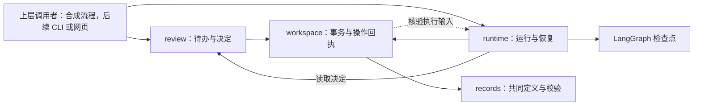

# 架构、工作空间与恢复

说明模块依赖、技术职责、文件归属及可靠保存与恢复。记录字段由 [数据记录与填写格式](records.md) 维护，用户操作顺序见 [文献处理流程](workflow.md)。目录图为目标布局，现有能力见 [README](../../README.md)。

返回 [设计总览与阅读入口](../design.md)。

## 业务架构与依赖

系统采用一个 Python 应用，按工作内容分成五个模块，共用记录格式、配置和工作空间。只有实际需要时才增加新的代码层次。

| 模块 | 负责的结果 | 主要依赖 |
|---|---|---|
| `pipeline` | 获取材料、提取名单与数值、关联对象、补充外部资料，并安排这些步骤的执行顺序 | `llm`、裁决功能、共用记录格式、配置和工作空间 |
| `llm` | 解析模型配置、组合提示、调用接口、保存响应和用量 | 配置、方法提供的提示和运行记录 |
| `review` | 展示证据与待办，保存决定和案例，提供命令行及网页操作 | 共用记录格式和工作空间；通过统一的运行入口恢复任务 |
| `catalog` | 准备待审星表、导出数据、生成网站和执行获准发布 | 经检查的工作结果、正式记录及发布状态 |
| `evaluation` | 固定实验输入与配置、调用提取功能、生成评分报告，并提供 Gold 工具 | `pipeline` 对外提供的提取接口；获准使用的私有答案 |

共用基础模块不导入具体提取、网页或评测的内部代码；运行恢复通过裁决共同接口读取已保存决定。裁决模块向提取流程、网页和 CLI 提供创建和查询待办、保存决定的共同接口；流程执行部分负责恢复对应任务。页面模板只负责展示，不负责科学判断或写入数据库。流程图安排步骤顺序，具体提取和检查由对应模块完成。执行顺序与重复操作的处理见 [保存、恢复与版本](#保存恢复与版本)。

日常提取与评测（benchmark）调用同一个提取接口。提取完成后，评分程序单独读取 Gold；提取程序不接收答案、Gold 路径或逐项评分数据。产品有文献处理、Gold 标注和评测三类任务。

方法与步骤统一在代码中登记，命令行根据实际实现展示可用功能。Gold 保存和评分等顺序任务可以使用普通函数。

### 技术选择与责任

| 技术 | 采用理由与职责 |
|---|---|
| Python、uv 和锁文件 | 统一开发语言、依赖和安装方式 |
| arXiv API 与源码下载 | 获取专家指定范围的文献元数据和 LaTeX 源码包 |
| LangGraph | 安排流程、暂停与恢复；科学规则和可靠写入由应用负责 |
| SQLite | 本机保存业务数据；恢复与备份要求见下文 |
| Pydantic | 定义和检查记录格式，并生成格式说明 |
| FastAPI/Jinja2 | 提供本地裁决网页，与命令行共用业务功能 |
| Astroquery | 查询审定的天文数据库并保留出处 |
| 静态 HTML/CSS/JavaScript | 根据固定数据版本生成网站和下载入口 |

LangGraph 的定位见[官方概览](https://docs.langchain.com/oss/python/langgraph/overview)，中断与重入行为见[官方中断说明](https://docs.langchain.com/oss/python/langgraph/interrupts)。依赖在实际引入时锁定，技术采用以当前实现的实际验证为依据。

## 目录与文件职责

本节说明模块和资料放在哪里、哪些内容进入发行包。代码布局保留到模块层级，内部文件在实施时细化；调整后同步相关说明。

### 主仓目标布局

```text
hvs-catalog/
├── README.md、AGENTS.md、CONTRIBUTING.md
├── pyproject.toml、uv.lock      # 包定义、依赖与版本
├── src/hvs_catalog/
│   ├── records/                # 共同记录定义与校验
│   ├── workspace/              # 空间、事务、锁与备份
│   ├── runtime/                # 运行绑定、结果复用与恢复
│   ├── pipeline/               # 文献处理
│   ├── llm/                    # 模型调用
│   ├── review/                 # 裁决与案例
│   ├── catalog/                # 星表生成与发布代码
│   ├── evaluation/             # 评测和 Gold 工具
│   └── resources/              # 科学规则、提示和模型配置
├── catalog/                    # 正式数据：论文、对象及版本清单
├── contracts/generated/        # 从代码生成的数据格式说明
├── tests/                      # 测试与可公开样例
├── tools/                      # 开发检查工具
├── docs/                       # 设计、指南内容和操作说明
├── .github/                    # 自动检查与获准发布配置
├── .dev/                       # 开发计划与进度
│   ├── plan.md
│   └── progress.md
└── .work/                      # 默认运行工作空间
```

根目录的 `catalog/` 保存正式数据，源码中的同名目录保存处理程序。产品文档、测试、开发材料和运行结果各自存放，发行范围见下方“内容进入哪里”。

### 代码内部布局

五个模块的职责与调用关系见 [业务架构与依赖](#业务架构与依赖)。内部组织按 [开发工作约定](../../CONTRIBUTING.md#开发工作约定) 调整。

数据格式由代码定义并生成说明，[记录职责](records.md#记录职责) 解释各类记录负责保存什么。科学规则的输入来源见 [科学规则的维护来源](extraction.md#科学规则的维护来源)。

### Gold 仓目标布局

Gold 仓的具体目录与使用要求统一见 [Gold README](../../../hvs-catalog-gold/README.md#资料结构与使用约定)，工具由主仓提供。

### 运行工作空间布局

工作空间的默认位置约定为主仓 `.work/`，也允许指定到仓库外；当前 Python 初始化入口接收显式路径。按运行需要保存以下内容，已采用的文件名见 [空间初始化与文件保存](#空间初始化与文件保存)。

| 内容 | 用途 |
|---|---|
| 运行配置、业务数据库和框架检查点 | 连接设置、实际结果与流程进度 |
| 来源材料 | 固定版本的论文及解析结果 |
| 运行与实验材料 | 请求、结果、配置、费用和诊断 |
| 发布候选 | 待审核数据、网站和下载文件 |
| 备份 | 能一起恢复的材料、业务记录和执行进度 |

演示空间与日常空间分开。Gold、最终评价预留材料和含答案分析的存放要求见下表；被 Git 忽略的必要运行材料仍须保留。

### 内容进入哪里

| 内容 | Git | 代码发行包 | 维护来源 |
|---|---|---|---|
| 程序、规则、必要提示、稳定配置与界面资源 | 主仓 | 按运行需要包含 | 源码与已确定且可公开的资源定义 |
| 正式星表 | 主仓 | 排除，独立提供数据下载 | 获准发布的具体内容 |
| 产品文档及通用规范 | 主仓 | 不作为运行依赖 | 对应文档正文 |
| 核心重构计划、进度与当前交接 | 主仓只纳入这两份文件 | 排除 | `.dev/plan.md` 与 `.dev/progress.md` |
| 本机开发材料、认证凭据、环境、缓存和运行产物 | 忽略 | 排除 | 本机或运行空间 |
| 正式 Gold、材料清单、审定及来源记录 | Gold 私库 | 排除 | 私库正式记录 |
| Gold 草稿、最终评价预留材料与逐项评分 | 不进入 Git | 排除 | 私有工作空间 |

两仓的 `.gitignore` 落实上述范围；主仓 `.dev/` 只纳入计划和进度，Gold 仓忽略整个 `.dev/`。安装包的实际范围由构建配置定义，并检查构建产物。

完整克隆 Git 仓库时，会同时下载纳入版本管理的正式数据。只安装程序时，使用代码发行包。初始化空白工作空间与导入已有正式数据是两个操作，只有用户明确要求时才导入数据。

## 保存、恢复与版本

每次运行都固定来源材料、规则、代码和依赖的版本，以及方法、各步骤模型与参数、实际提示、配置和所用案例，包括是否启用运行中专家裁决、可使用的已有决定，以及实际发送的英文规则、提示、字段说明、示例和判例。操作标识和缓存判断须包含这些会影响结果的输入。恢复时使用原来保存的输入；输入改变后，记录为一次新的执行，避免错误复用旧结果。按步骤和模型记录用量，汇总整次费用；无法确定的用量或费用标为未知，记录中不保存认证凭据值。

业务数据库保存实际结果和裁决决定，框架检查点保存流程执行到哪里。先把结果和裁决决定保存到磁盘，再请求恢复；重启后根据已保存记录核对状态。无论从命令行还是网页启动，同一工作空间中的同一任务，同时只能有一个执行者。备份须让材料引用、业务记录和检查点保持对应，恢复后能够检查它们是否一致。

恢复流程时，框架可能再次执行某个步骤。输入相同时，复用已经可靠保存的结果；相同决定重复提交只生效一次，冲突或基于过期材料、规则的决定明确拒绝。如果收到远程服务响应后、保存前发生故障，恢复时可能再次调用服务。因此，外部调用仍可能重复发生。

软件版本只在 `pyproject.toml` 中定义，运行时从已安装包的信息中读取。记录格式、科学规则和正式数据分别有自己的版本，运行或发布清单记录使用了哪些版本。运行 ID 和方法名称不用于另行定义软件版本。

## 工作空间与恢复接口方案

本节细化保存与恢复要求，裁决业务接口见 [裁决共同接口方案](review.md#裁决共同接口方案)，交付范围和验收场景见 [R05](../../.dev/plan.md#r05)。

### 方案选择与代价

| 决策 | 选择与理由 | 代价及其他方案 |
|---|---|---|
| 保存记录 | 沿用 SQLite，直接保存共同定义的 JSON 记录，另设查询索引和操作回执。科学记录按编号与修订只增不覆盖。 | 比直接散存 JSON 多一层事务代码，但能一起提交关联修改。业务事实全部塞入框架检查点会混淆职责，不采用。 |
| 并发控制 | 首版对同一工作空间的修改和流程执行串行加锁，暂停等待专家后释放锁。不同工作空间可独立执行。 | 同一空间中不同任务也不能同时推进；换来较小的锁与备份复杂度。逐任务并发及共享记录冲突调度暂不引入。 |
| 跨库恢复 | 业务记录可靠提交后再推进 LangGraph，通过持久化操作回执识别已经完成的工作。 | 业务库和检查点可能暂时处于不同进度，需要恢复核对；不把两个数据库的提交宣称为一次原子提交。 |
| 备份 | 持有空间锁，在没有执行者写入时生成数据库快照和材料清单；恢复到新目录。 | 备份期间该空间不能推进，恢复需要额外磁盘空间。首版不做边运行边复制整套空间，也不覆盖已有空间。 |

这些决定只覆盖本机文件系统和当前已验证的 macOS 环境。锁适配器须明确支持范围；其他平台未验证时报告限制，不能悄悄退化为不加锁。网络文件系统的锁和断电耐久性不由进程终止测试证明。

### 模块与共同入口

`records`、`workspace` 和 `runtime` 提供共同运行基础。`workspace` 负责目录、文件、数据库、锁和备份；`runtime` 负责运行绑定、步骤结果复用和框架恢复。`review` 负责待办和决定，依赖 `records`、`workspace` 的公开接口。上层调用者先保存决定，再调用 `runtime` 恢复；基础模块不导入提取、网页或评测的内部代码。



当前备份检查复用 `runtime` 的执行输入核验；具体流程由调用方提供的适配器连接。下表列出公共入口及行为，改变这些约定时先回到设计审定。

| 接口 | 输入与结果 | 必要约束 |
|---|---|---|
| `initialize_workspace` / `open_workspace` | 显式路径；返回可访问空间身份与配置的 `Workspace` | 初始化不导入正式数据；打开不会隐式初始化或修复未知空间。 |
| `RecordStore.commit` | `CommitRequest` 包含操作键、预期当前修订、本批新记录和结果引用；返回 `Receipt` | 调用方持有空间锁，提交在单次业务事务内核对版本；同键同内容返回原回执，同键异内容拒绝。 |
| `RecordStore.read_record` | 准确记录引用；返回记录，不存在时返回 `None` | 不隐式改为最新修订；查询不创建记录。 |
| `runtime.get_execution` | 空间与执行 ID；返回 `ExecutionHandle`，不存在时抛出 `WorkspaceIntegrityError` | 查询不创建运行、决定或科学结果。 |
| `create_execution` | 调用方请求键、`InputSnapshot` 和可信代码提供的流程标识/版本；返回 `ExecutionHandle` 与是否复用的布尔值 | 同一请求同输入重试复用；有意重跑使用新请求键。输入改变以新执行保存，不能改写原快照。 |
| `commit_step_result` | 执行、步骤、输入摘要、结果记录及输出引用；返回 `Receipt` | 结果记录、运行的新修订、实际输出引用和回执一并提交。 |
| `resume_execution` | 执行 ID 与调用方提供的匹配版本流程适配器；返回暂停、完成或失败报告 | 只读取已保存决定；不接收自由文本决定来直接恢复。流程版本不兼容时拒绝推进。 |
| `backup_workspace` | 源空间与新的备份位置；返回 `BackupReport` | 校验材料、业务记录与检查点的对应关系；失败产物不标记为完整备份。 |
| `restore_workspace` | 备份与新的恢复目录；返回 `Workspace` | 校验通过才发布可用空间；拒绝覆盖已有目录。 |

流程适配器负责把步骤结果与已保存决定映射到流程状态，R05 用合成实现验证接口。只允许调用者提供的可信程序，不从记录中的字符串动态导入或执行代码；正式提取步骤和方法登记由 R09 及后续任务接入。

### 空间初始化与文件保存

空间采用 `workspace.json` 身份与格式标记、`config.json` 本机配置、`business.db`、`checkpoint.db`，来源和运行文件分别放在 `sources/`、`runs/`，备份放在 `backups/` 或明确的外部位置。记录内文件路径统一相对于空间根目录，路径解析后仍须位于根内。配置保存认证引用，认证凭据值不写入配置快照、归档或错误正文。

已有非托管文件可以保留；初始化前检查所有拟占用的文件名，发生冲突时整体拒绝，不能覆盖或把 R02 演示数据库当成正式空间。重复初始化同一兼容空间只读取已有配置；配置变更走明确更新操作。演示空间和正式空间的格式标记互不兼容。

初始化使用绑定空间身份的预写清单（WAL）：每个发布条目先登记并可靠保存，再实际发布，完成标记最后发布。清单只允许初始化协议规定的根级名称与类型，不能授权删除任意路径。初始化期间不替换所持锁依附的文件。

中断后的回滚及完成后的残留清理均在暂存目录内的初始化互斥锁保护下进行。删除前须完整预检清单、全部目标路径和暂存内容，核对类型、文件哈希及目录内容；任何一段符号链接都拒绝且不跟随。预检通过才逆序删除已确认的自身产物，回滚后重新初始化；完成后的清理还要求清单状态为完成且绑定当前空间。

清单是暂存目录归属的唯一证明。清单缺失或损坏、未知文件、哈希不符或应为空的目录非空时，整体拒绝并保留现场，不补写清单或接管未知目录。未知空间格式、标记与数据库身份不符均明确报错，不自动迁移。

材料先写同一文件系统的临时文件，核对哈希并可靠发布，再允许数据库记录引用该路径。已有相同路径和内容可复用，内容不同则拒绝覆盖。发布文件后、业务事务前中断可能留下未引用文件，但不能留下指向半份文件的有效业务记录。保留必要诊断，不自动清理用户资料。材料导入使用显式本地文件清单；R05 不下载真实论文或自动导入正式星表。

### 业务事务、修订与运行输入

业务库存储记录原文、当前修订索引、执行/步骤/待办绑定和操作回执。记录 JSON 是科学内容来源；索引可以重建。操作回执含操作键、请求内容摘要、相关执行与步骤、决定和前后记录引用、应用阶段及错误，用于防止重复生效，必须备份，不能当作可随意丢弃的查询缓存。回执是内部运行元数据，不另起一套科学记录格式。

一次修改先组装完整候选记录集合，通过共同集合校验并检查材料与运行文件引用；在事务内再次核对预期当前修订，然后追加新修订并更新索引和回执。相同编号与修订只能保存相同内容。并发读取的旧内容不能覆盖新修订。较早记录继续引用原来准确的材料和证据。

除历史集合合法外，还须核对本步骤声明的当前输出是否相互对应。例如新的名单与论文贡献必须一起形成一致结果，不能借历史论文仍指向旧名单让错误的新名单通过。跨记录变更由调用方明确给出前后引用和完整结果，程序只做已声明的确定性引用调整；缺少必要贡献内容或需新增科学判断时拒绝应用并保留错误。禁止遍历历史记录后把全部引用换成“最新版本”。

运行输入和复用键来自完整快照及步骤实际输入，不只使用模型名、论文名或执行 ID。保存来源、规则、代码与依赖版本，并将实际使用的规则及提示等文件按内容固定；创建运行时尚未发送的请求保留为空，之后逐次归档实际请求和响应，恢复时先复用已归档响应再考虑重新调用。提交、备份、恢复与完成检查共同核验全部记录修订引用的归档文件，包括每次请求与响应；核验使用记录原哈希。

提取输出身份按执行隔离：名单、论文贡献、对象与问题等执行产物的编号由执行派生，同空间有意重跑（新请求键）或改变配置后的新执行各自生成新编号，结果、决定与回执互不混用；来源包与证据等固定输入可跨执行共享，同内容按不可变修订复用。

恢复优先核对原快照和归档的完整性。当前配置文件改变不改写旧运行；当前规则文件变化后，仍可使用已归档的原规则。原文件损坏或缺失不能用新版替代。当前代码/流程或依赖与固定版本不兼容时报告恢复受阻，不能改填清单使其看似一致；当前实现对流程适配器、代码和依赖版本要求精确匹配。

专家裁决配置与实验边界见 [专家裁决开关](review.md#专家裁决开关)。首版步骤缓存限定在本执行内；相同配置的另一次执行也不自动复用另一执行的中间结果。关闭组拒绝本轮专家决定及其衍生结果，只允许按输入快照明确固定、并经适用性核对的已有决定，不扩大其使用范围。

### 锁、提交与恢复顺序

所有空间写入、执行推进和备份共用一个排他锁，先取空间锁再进入业务事务；框架写入也受同一锁保护。当前平台使用 `fcntl.flock` 非阻塞加锁，进程内防止其他线程借用持有记录。拿不到锁返回忙，不自动创建第二个执行。

稳定锁文件不随正常释放而删除，进程退出由系统释放锁；文件存在不等于持锁，删除文件也不能解除活跃锁。锁文件缺失或身份异常时拒绝继续，确认无执行者后通过 `repair_lock` 显式修复。`exec` 子进程不继承锁描述符；`fork` 子进程清理继承的描述符与重入记录，重新加锁，且不能释放父进程的锁。清理不得等待继承的普通线程锁，以免因持锁线程未被复制而死锁。

执行期间可以持空间锁，但不把模拟服务或未来网络请求包在长期 SQLite 事务内。暂停后释放锁，后续任务可依次运行。读状态只展示已提交业务事实；若同时读取框架状态，应取得一致读条件或明确标为执行中快照，不能据此自动修改状态。

裁决恢复分为三个可识别阶段。答复产生的 `answered` 修订由同一保存回执关联，恢复时允许沿此关联读取原问题和决定；它本身不构成“目标已被其他操作修改”。其他问题替代或科学目标修订仍须执行过期检查：

1. **保存决定。** `review` 在业务事务中保存决定、问题的答复修订及待处理回执。提交完成后才向调用方报告已保存；此时结果可以尚未更新。
2. **应用决定。** `runtime` 取得锁并先完整核对当前执行的检查点（流程状态、执行绑定与状态内记录引用），再重查适用性：已知不一致时保留已保存的决定并记录诊断，不产生新的科学结果修订或应用回执；"业务已提交、框架落后"的合法阶段仍按回执继续。由受控的条目修改和步骤适配器组装新结果，按完整集合校验；结果修订、运行输出引用和应用回执在同一业务事务提交。已存在应用回执时复用对应结果，不再次增加修订。
3. **继续流程。** 从匹配的检查点恢复，节点先查步骤及决定应用回执再处理。恢复调用失败可以重试，不能撤销已经可靠保存的决定，也不能仅因调用返回就宣布完成；完成状态须同时证明业务结果完整与框架到达结束节点（没有待执行节点），二者缺一都按不一致停止。

专家仍无法判断时按 [裁决状态规则](review.md#裁决共同接口方案) 保留未决，不能把第二阶段执行成科学解决。决定保存后若发现目标已发生其他修订，标记本次应用受阻，保留原决定和诊断；不得把补丁自动移植到新目标。

框架进度落后于已提交业务事实时，通过重入和回执完成剩余步骤。检查点引用不存在的业务结果、串到其他执行，或业务与框架内容存在无法解释的冲突时，停止该执行并报告不一致。框架恢复重新进入节点的行为参考 [LangGraph 中断说明](https://docs.langchain.com/oss/python/langgraph/interrupts)。

### 备份与恢复验证

取得空间锁后，核对数据库、记录和文件，使用 SQLite 备份接口分别生成业务与检查点快照，同时复制全部已保存记录引用的来源、运行文件及必要空间配置。两次数据库快照期间禁止写入，才能让它们对应同一稳定状态；不能直接复制正在使用的 `.db` 并遗漏日志内容。技术依据见 [SQLite backup 接口](https://docs.python.org/3/library/sqlite3.html#sqlite3.Connection.backup)。

备份、恢复与完成检查共用以下一致性要求：

- **文件与记录：** 全部记录修订引用的归档文件按原哈希核验，包括历史运行与每次请求、响应；备份清单不能替代这项核验。
- **检查点与业务：** 逐线程核对执行绑定及状态内记录引用。允许“业务已提交、框架落后”的可解释阶段，拒绝无法解释的错配。
- **完成状态：** 运行层使用调用方提供的匹配流程确认框架已无待执行节点，再将最终检查点标识、内容摘要与完成修订同事务保存。摘要带版本标记，按数据库原始字节计算，覆盖检查点行及待写入状态。其他入口重算并比较标识与摘要，无需依赖具体流程；凭据缺失、追加检查点或原检查点内容变化均阻止接受完成状态。

缺失的完成凭据只能由调用方提供匹配流程、实际核验后补记。先构造当前快照的完整候选凭据，逐项核对已有值；任一冲突立即拒绝并保持原值，全部相符才在一次事务中补齐缺失项。

备份清单记录空间身份和格式、每个文件的相对路径/长度/哈希、数据库快照、固定运行版本及备份完成状态。包括历史修订所需证据、操作回执和框架完成凭据，不包含其他备份、锁文件、临时文件、认证凭据或空间外资料。只有全部核对成功后才发布完整备份；损坏、漏文件、重复目标路径及越界引用都失败。

恢复只接受新的目标目录，先在同级临时目录完成哈希、数据库完整性、全记录引用和运行/检查点绑定校验，再发布可打开的空间。读取备份清单与每个源文件前逐段验证路径，任何一段符号链接或越界都拒绝，不能只检查末端文件。拒绝覆盖已有目录；恢复保留逻辑空间身份与执行 ID，锁在新位置重新建立。旧空间和恢复副本之间不自动同步结果。

完整备份可以含“决定已保存、结果待应用”或“结果已应用、框架待恢复”的可解释状态，恢复后仍按回执继续。检查点与业务结果不一致且无法按上述规则解释时，不把备份认作可恢复。验收必须在新目录启动新进程继续执行，不能只报告文件复制或 SQLite 完整性检查成功。
