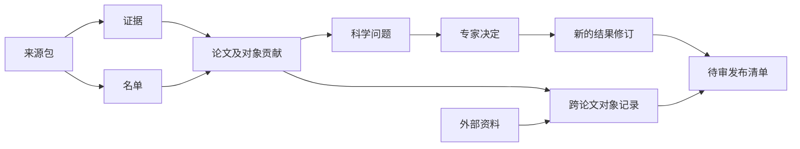

# 数据记录与填写格式

说明各类记录保存什么、如何引用，以及提取者填写内容怎样转换为保存记录。R04 实现主要阅读本文件；旧格式复用依据和科学例子集中在文末。程序运行与恢复见 [架构设计](architecture.md#保存恢复与版本)，当前实现及验收状态见 [交接](../../.dev/progress.md)。

返回 [设计总览与阅读入口](../design.md)。

实施时先读 [记录职责](#记录职责)、[核心记录与填写格式](#核心记录与填写格式)、[逐量完成情况](#各物理量的提取完成情况)、[英文填写要求](#英文填写要求与生成范围) 和 [验收场景](#合成记录与验收对应)。文末 [设计依据与例子](#论文贡献的设计依据与例子) 用于核对旧格式复用和科学表达，不作为另一套字段定义。

## 记录职责

下文给出 R04 的实施设计，正式字段和允许取值由共同代码定义生成。“内容哈希”是根据文件内容计算的标识，用于检查内容是否变化。

| 记录 | 负责保存什么 |
|---|---|
| 论文与来源包 | arXiv 标识与具体版本、来源包、原文位置及未处理的材料范围 |
| 论文贡献 | 对象、本篇研究的简短摘要、贡献类型、作者总体判断、各条件下的结论与测量及原文证据 |
| 名单结果 | 对象角色、方法、证据及完成或未决状态 |
| 对象与外部记录 | 稳定身份、别名、关联依据及有出处的外部资料 |
| 裁决 | 问题、决定、理由、操作者和适用的材料与规则版本 |
| 运行清单 | 实际输入、规则、方法、模型、提示、专家裁决配置、代码与依赖版本、案例、结果和用量 |
| 发布清单 | 数据版本、内容哈希、来源运行与代码、修改摘要、批准及各渠道结果 |

论文记录保存该论文的元数据和贡献；对象记录通过引用关联论文测量，避免同一内容在两处分别修改。对象改名不改变稳定身份；合并、拆分及科学更正保留理由和依据。

## 核心记录与填写格式

本节规定 R04 的记录结构与约束，实施时同时采用后文的简化填写要求。正式 Pydantic 模型、JSON Schema、生成说明和填写模板由 GLM 实现后交验收；当前实现与验收状态由 progress 维护。后续关卡的服务、评分、运行恢复和发布操作仍按原计划交付。

下图表示材料、结果与后续使用的关系；引用均固定到具体修订，运行清单记录实际输入及输出。

### 保存形式、版本与共同字段

采用 UTF-8 JSON 作为记录的保存和交换形式，Pydantic 作为格式定义与检查的共同来源。工作空间的 SQLite 后续保存同一份记录内容及检索所需索引；索引可重建，不能成为另一份独立维护的科学结果。R04 验证 JSON 写入读回和记录间引用；数据库事务、锁和恢复由 R05 实现。

每份记录外层使用以下字段，具体内容放在 `data`。字段类型、必填与可空须在共同定义中明确，未声明的字段报错。下表中的必填字段不得以默认空列表掩盖模型漏填；只有含义已经明确的“没有项目”才允许显式 `[]`。

| 字段 | 类型与约束 | 谁提供 |
|---|---|---|
| `schema` | `{name, version}`；`name` 为下表记录类型，`version` 首版为整数 `1`；未知名称或版本报错 | 程序 |
| `record_id` | 非空稳定技术标识，同类型修订沿用；不得用名称近似替代身份判定 | 程序 |
| `revision` | 从 `1` 开始递增的整数；已有修订内容不可原地覆盖 | 程序 |
| `created_at` | 含时区的时间 | 程序 |
| `execution_id` | 关联创建它的执行；人工导入可空，不能凭此单独复用结果 | 程序 |
| `data` | 对应记录类型的内容 | 按字段职责 |

记录引用 `RecordRef` 固定为 `{record_id, revision}`；指向记录内部项目时另加该项目的 `item_id`。读入记录集合时检查目标存在、类型和所属论文正确；不按“最新版本”悄悄替换。文件引用 `ArtifactRef` 为 `{path, sha256}`，路径相对声明的材料或运行目录，禁止越出目录；哈希由程序计算，不能要求模型猜测。保存集合要验证全部引用，可以引用同集合中的记录；引用保存标识，不递归嵌入记录。

选择独立证据记录而不是在每个字段复制引文，可以共享原文并检查引用；代价是保存和导出时须同时包含对应证据、材料清单及修订。单条记录格式正确、集合引用正确和科学内容正确分别验证。数值字符串、原始名称和原文片段不因读写被换算、四舍五入或改写；便于检索的规范化键单独保存或派生。

### 论文、来源与证据

| 记录类型 | `data` 内的主要字段与要求 |
|---|---|
| `source_package` | `paper_key`、`origin`、`source_version`、`files[]`、`gaps[]`。真实来源的 `origin` 保存 arXiv 标识与获取依据；合成材料明确 `kind=synthetic`。每个文件有 `file_id`、包内路径、哈希、媒体类型、角色和 `read_state`（`ready/unparsed/unreadable`）；解析结果另存 `derived_from[]` 和转换信息，原件保留 |
| `evidence` | `paper_key`、`source_ref`、`file_id`、`locator`、`excerpt`。定位必须对应指定版本的实际材料；引文按原文保存，数值组件再保存对应的原始数字片段 |
| `paper` | `paper_key`、`metadata`（标识、版本、标题、作者等已知元数据；未知可空）、`source_ref`、`roster_ref`、`object_contributions[]`。贡献内容在本篇记录中维护；外部记录及对象总记录通过引用关联 |

`paper_key` 是固定版本论文的共同标识；不同版本不能混合证据。`source_ref` 再固定实际输入资料。来源包不含模型给出的科学判断。`gaps[]` 每项有 `gap_id`、`reason`（`missing/unreadable/unparsed/external_not_included`）、`description`、`file_id`（无文件时为空）、`mention_evidence_refs[]` 及 `affected_targets`。不能确定影响范围时显式记 `scope=unknown`；范围已知时列出对象、物理量或收录/身份等判断。缺口不存在的文件不编造哈希或行号。

证据位置 `locator` 采用互斥的三种结构：

| `kind` | 位置字段 | 检查方式 |
|---|---|---|
| `text` | `start_line`、`end_line`，从 1 开始且包含端点 | 在指定文本版本中核对行范围和引文 |
| `table_cell` | `row_key`、`column`、可空的 `row_number`；另存对象标识和表头上下文引用 | 在指定表版本中定位单元格；转换表保留回原件的映射 |
| `data_element` | `selector`（有类型的字段/记录定位，如 JSON Pointer、FITS 扩展/行/列）及 `decoder` 信息 | 通过声明的解析方式定位原始元素；不伪造文本行号 |

R04 用合成材料核对定位结构及引用，不在本关交付所有文件格式的解析器。实际定位尚不能验证的材料保持未处理，相应提取不得据此标为完整。`excerpt` 保存可回查的原文；非文本元素保存解码后的原始值表达及解码方式，保留文件哈希。单位、参考系、历元和条件可以引用其他证据，不必强行塞入数值所在单元格。

### 名单与对象贡献

`roster` 保存 `paper_key`、`source_ref`、`method`（`direct/candidate_review`）、`coverage`、`entries[]`、`unresolved_groups[]` 和 `issue_refs[]`。`coverage` 关联材料范围及缺口。每个条目包含程序分配的 `item_id`、`identifiers[]`、`disposition`（`included/excluded/pending`）、`evidence_refs[]`、`issue_refs[]` 和可空的 `contribution_id`。收录条目必须对应本篇贡献；排除或待决条目不创建伪造的已收录贡献。

名单未完成时仍可保存已明确的对象和待决项。原文只给范围而未列清成员时，在 `unresolved_groups` 保存原文范围、证据、已明确成员与未完成原因；不生成缺失成员。完整名单的空 `entries` 才可结合材料范围表达“没有符合条件的对象”，技术失败及缺口不能靠空列表表达。

论文内每项 `object_contributions` 的字段如下。技术编号由程序统一分配；步骤间由程序提供已有编号，模型不得另造一套身份。

| 字段 | 类型与约束 |
|---|---|
| `item_id`、`roster_item_id` | 论文内贡献编号及其名单条目编号；校验一一对应的收录关系 |
| `identifiers[]` | `{value, evidence_refs[]}`；保留本篇名称原样，非空；外部别名不写入此处 |
| `contribution_summary` | `{text, evidence_refs[]}`；非空英文自由文本，简述本篇实际研究 |
| `contribution_type` | `{value, evidence_refs[]}`；值为 `candidates_found/follow_up`，独立回查类型证据 |
| `paper_boundness` | `{status, evidence_refs[], issue_refs[], gap_refs[]}`；已判断使用 S04 五种状态；尚不能判断时 `status=null` 且必须关联原因，不能用空字符串或第六种作者状态 |
| `conditional_assessments[]` | `{condition, statement, evidence_refs[]}`；保存作者在不同条件下的原始结论，新写说明为英文；不由模型按多数投票合成总体结论 |
| `quantities[]` | 每项 `{quantity, values[]}`，同一种量只占一组，`values` 非空；没有结果时不建空组 |
| `quantity_conflicts[]` | `{conflict_id, quantity, reason, alternatives[], issue_ref}`；至少两个不同的完整数值表达，关联问题；冲突双方不得同时作为已确认值 |
| `quantity_coverage[]` | 恰好包含规则范围内每种量一次；每项 `{quantity, state, checked_file_ids[], gap_refs[], issue_refs[]}`，`state=not_checked/partial/complete`；检查范围引用本篇材料 |
| `precedent_uses[]` | `{precedent_ref, applies_to[], explanation}`；仅实际使用时填写，空列表合法；版本和已审定状态由程序校验 |

物理量编码沿用旧格式的 18 个 `legacy_path`，按当前 R03 `quantities` 定义映射，避免另手工维护一份词表。五种作者状态以 R03 来源为准。只有无总体结论这一状态允许没有正面结论引句，但必须能回查已检查材料；材料缺口或解释疑问不得用此状态代替。`candidates_found` 的收录关系按 S03/S04 校验，不能仅凭状态名称自动收录。

各物理量的完成含义见 [逐量完成情况](#各物理量的提取完成情况)。`complete` 表示材料查阅已完成，仍可带数值冲突；程序据数值、相关缺口和未决问题生成说明，如“有结果”“未报告”“部分结果”“待裁决”或“尚未完成”，这些说明可并存，不让模型再填一份可能矛盾的汇总标签。涉及收录或身份的疑问阻止相应贡献被当作已确认结果使用。

### 每组数值的字段

| 字段 | 表达与约束 |
|---|---|
| `value_id` | 本篇范围内的数值编号，由程序提供或分配 |
| `value` | 原始数值字符串；纯区间为空。角度可保留时分秒形式，不能自动转成浮点角度 |
| `unit` | 原报单位；原文及上下文均未提供时为空，不自行猜测 |
| `error`、`lower_error`、`upper_error` | 原报对称或非对称误差；没有报告的一侧为空，不能补成 0；不能把同一误差同时写成对称和非对称两种形式 |
| `limit_kind`、`range_lower`、`range_upper` | `none/lower_limit/upper_limit/range`；界限用 `value`，纯区间用两端点，不能补中心值。端点是否包含按原文可空记录为 `lower_inclusive/upper_inclusive` |
| `interval_kind` | 纯区间取 `ordinary_range/prior_support/confidence/credible/statistical_interval/unspecified`；最后一项明确表示原文未说明区间解释，不推断统计意义 |
| `coverage`、`lower_quantile`、`upper_quantile` | 作者确实报告时保存 `{value, unit, direct_evidence[]}`；不从分位点推算覆盖率，不补默认置信水平 |
| `error_components[]` | 每项 `{name, error, lower_error, upper_error, direct_evidence[]}`，保留具名分量，不能计算总误差。若作者同时报告总误差及分量，顶层误差保存总误差，须有独立证据和明确说明 |
| `condition` | 非空英文条件说明；包括已知模型、先验、数据、历元和参考状态，未知不补。仅上下文未给条件时写明 `No additional condition reported.` |
| `frame`、`epoch`、`coordinate_format`、`representation`、`purpose` | 可空的原文描述/格式标签：坐标约定、历元、数字表示和该值用途；不把零点校正、样本阈值或其他物理量误放为对象结果 |
| `source`、`source_note`、`author_usage` | `this_paper/prior_work/unclear`，来源说明和作者是否采用、替换或否定的原文意思；没有明确说法时后两项可空，不选择推荐值 |
| `direct_evidence[]` | 每项 `{part, evidence_ref, raw_fragment}`；覆盖实际填入的每个数值组件，包括误差和端点；同一组件可引用多次出现的证据 |
| `context_evidence_refs[]` | 单位、条件、来源、参考系及用途等支持证据，可与数值证据共享位置 |

相对旧校验有三处调整：原文只给一侧误差时保留该侧；原文未说明区间解释时允许 `unspecified`；作者明确同时给出总误差和具名分量时允许并存。它们用于保留原文，不推算缺失内容；不能因旧校验不接受就删去原文数据。输入无法可靠拆分时保留原始证据并提出问题，不能捏造完整数值结构以通过校验。

### 对象身份与外部记录

| 记录类型 | `data` 内的字段与约束 |
|---|---|
| `object` | `object_id`、`display_name`、`aliases[]`、`contribution_links[]`、`external_links[]`、`changes[]`。每项关联有固定修订的目标引用、`state=confirmed/pending/rejected`、`basis` 和证据/决定引用；候选关联不能作为确认事实 |
| `external_record` | `service`、`catalog_version`（未知为空）、`queried_at`、`query`、`raw_response`、`entries[]`。原始响应为带哈希的文件引用；每条返回保留 `entry_id` 和 `fields[]`，字段含名称、原值、单位及响应内位置；误差、质量信息和历元按实际返回保存 |

`object_id` 不因改名变化。`changes` 保存合并、拆分或修订的类型、前后对象引用、理由和依据；保留历史，不重写各篇论文。外部响应只说明服务返回了什么，身份匹配状态放在关联项中；真实 SIMBAD/Gaia 字段、版本和查询范围仍在 R19 审定，R04 不预选科学字段或调用服务。

### 疑问、决定与处理状态

`question` 保存 `category`、`target_refs[]`、`source_refs[]`、`rules_ref`、`prompt`、`evidence_refs[]`、`gap_refs[]`、`context_refs[]`、`fingerprint`、`status` 和 `decision_refs[]`。类别至少包含收录、身份、作者判断、数值冲突、物理量归属和其他科学解释；明确技术缺口进入材料/运行错误记录，不要求专家为解析失败作科学决定。`target_refs` 固定问题涉及的记录修订及字段/项目，问题指纹由实际目标、证据、材料和规则计算，不能只按显示文字生成。

`decision` 保存 `question_ref`、`question_fingerprint`、`actor`、`decided_at`、`outcome`、`answer_original`、`answer_en`、`reason`、`evidence_refs[]` 和 `result_patch`（未形成可应用结果时为空）。`outcome=resolved/unresolved`；补丁是对已声明目标的有类型修改，不能包含可执行命令。程序核对批准内容、问题版本和补丁后另存新结果修订，不能凭自由文本自动重写通用规则。

问题可处于 `open/answered/superseded`。`answered` 只表示收到答复：当专家答复“仍无法确定”时，决定为 `unresolved`，科学问题继续未决。新材料或规则使问题变化时建立新问题或修订并标记旧问题失效，旧决定不得套用。模型在纯 AI 实验中的处理记录到该执行的模型判断中，不创建 `actor.kind=human` 的专家决定。

| 内容 | 保存位置 | 不能混淆的情况 |
|---|---|---|
| 作者怎么判断 | `paper_boundness.status` | `no_overall_conclusion` 是一种明确科学读法 |
| 材料查阅完成到哪里 | 名单 `coverage`、各量 `quantity_coverage` | 已查完仍可能有冲突；空数值不证明未报告 |
| 还有什么科学问题 | `question`、`decision`、冲突项及关联状态 | 收到答复不等于问题已解决 |
| 程序运行到哪里 | 运行和步骤 `state` | 请求成功不保证提取完整，失败不产生成功空结果 |

### 运行与发布清单

`run` 保存 `execution_id`、`mode`（`daily/evaluation/synthetic`）、`input_snapshot`、`state`、`steps[]`、`result_refs[]`、`model_judgments[]`、`usage` 和 `errors[]`。执行状态为 `created/running/waiting_review/finished/failed/cancelled`；`finished` 表示本轮执行结束，科学完成程度从结果记录读取。

`input_snapshot` 必须固定来源记录、科学规则、方法、每一步模型与参数、代码和依赖版本、实际使用的英文提示/填写格式/示例/判例、专家裁决开关及可使用的已有决定。尚未发送的请求不伪造“实际提示”；每次真实发送另在步骤的 `attempts` 保存请求和响应的文件引用、状态、时间、用量、费用及已知的服务请求标识。超时后是否计费未知时费用为空，不能写零。凭据值不进入快照、请求归档或错误正文；认证以配置引用表达。

步骤保存 `step_id`、`state`、`input_refs[]`、`attempts[]`、`result_refs[]`、`error_refs[]`。结果复用核对完整输入快照，不能只依赖运行 ID。模拟数据明确标记 `synthetic`，不能据此报告真实模型质量或调用费用。评价运行记录 Gold 的隔离和评分输入由 R09 接续设计，提取请求不得包含答案或 Gold 路径。

`release` 保存 `data_version`、`content_refs[]`、`artifacts[]`、`manifest_sha256`、`source_run_refs[]`、`code_version`、`change_summary`、`approval` 和 `channels[]`。清单哈希只覆盖待批准内容和目标，不把批准回执或后来更新的渠道状态纳入自身哈希。`approval=null` 表示未获批准；非空时绑定批准人、时间、具体清单哈希及目标。每个渠道保存目标、`state=not_started/succeeded/failed`、回执引用和错误。一个渠道失败不能把全部渠道写成成功；格式正确不构成发布授权。

### 各物理量的提取完成情况

为每个对象单独记录当前规则范围内 18 种物理量的提取完成情况，使用 `quantity_coverage`，放在对象贡献内，与 `quantities`、`quantity_conflicts` 并列保存。这一记录粒度和位置已获人类专家确认。这里的“检查”指提取者查阅材料、提取该物理量的完成范围。逐项记录能表达“速度附表未处理，但距离已检查完”，并让程序发现某种量的检查声明被遗漏；省略一项不能视为已经完成。

填写时允许一次明确声明所有指定物理量的共同情况，再逐项填写例外，由程序展开成上述 18 项保存记录。共同声明必须由提取者提供，不能因没有返回某种量而默认它已检查完。填写与展开要求见[英文填写要求与生成范围](#英文填写要求与生成范围)。

材料检查状态为 `not_checked`、`partial`、`complete`，分别表示未检查、部分检查、相关材料已检查完。它们只描述材料检查情况。数值冲突和其他科学疑问单独关联，执行异常由程序记录；即使材料已检查完，仍可能存在未解决的科学问题。

| 合成情形 | 已保存数值 | 检查情况与问题 | 可给读者的说明 |
|---|---|---|---|
| 已检查对象的所有相关材料，找到距离 8.0 ± 0.5 kpc，没有影响该量的待决问题 | 保留距离值和证据 | 距离检查 `complete` | 已检查完，有结果 |
| 已检查对象的所有相关材料，没有报告视差，也没有相关缺口或疑问 | 不创建空测量 | 视差检查 `complete` | 已检查完，未报告视差 |
| 正文已有速度，但包内速度附表无法解析 | 保留正文速度 | 速度检查 `partial`，关联附表缺口 | 已有部分结果，尚未提取完整 |
| 距离正文和表格存在未解释的冲突，其他相关材料均已检查完 | 双方数值进入冲突项 | 距离检查 `complete`，关联开放冲突 | 材料已检查完，结果待裁决 |
| 数值提取步骤尚未开始，或调用失败且没有已保存的有效检查结果 | 不创建空测量 | 相应量保持 `not_checked`；程序另记未开始或失败 | 尚无有效检查结果 |

只有在固定材料与规则版本下，相关材料已检查完、没有影响该量的材料缺口或未决问题、且没有报告值时，才可将结果显示为“未报告”。没有正面的原文句子时，通过检查范围记录支持这一结论，不编造引句。模型声明“已检查完”本身不证明提取正确；仍须检查结果、材料范围和证据是否一致。

同一材料缺口可以关联多个物理量；材料清单和缺口正文共享引用，避免每种量重复填写。只有能够确定缺口的影响范围时，才让其他量保留检查完成状态；范围未知时，不能默认未列出的量不受影响。缺口涉及对象收录或身份时，按既有科学边界保持相应判断未完成。

运行中的技术失败不改写已保存且输入版本一致的有效结果，也不能自动补出检查完成声明。作者的五种总体判断由 S04 单独规定；“无总体结论”不用于表示这里的任何处理缺口。

### 英文填写要求与生成范围

R04 提交给模型的结构仅含当前步骤需要填写的内容，正式模板从共同定义生成；下面规定填写职责与转换要求，不能当作已生成或已实测的提示。

| 步骤填写格式 | 必须填写 | 程序提供或保存 |
|---|---|---|
| 名单提取 | 条目、原始标识、收录/排除/待决、研究摘要、贡献类型、作者总体及条件判断、证据、范围和缺口 | 固定论文/来源上下文，步骤方法、编号和运行信息 |
| 候选判断 | 程序给定候选的判断及对应科学字段；没有列清的组保持未完成 | 既有候选编号和材料引用；不能擅自增删候选以伪装完成 |
| 数值提取 | 程序指定对象的 `quantities`、`quantity_conflicts`、显式 `coverage` 声明、就地填写的证据及问题；必需列表即使为空也显式填写 | 对象编号、已有名单和来源上下文；展开后的 18 项完成记录、记录版本、调用状态和费用 |

每个对象的 `coverage` 必须包含 `scope=all_requested`、`common` 和 `exceptions[]`。`common` 明确声明本次请求给定的全部物理量的检查状态、已检查文件、材料缺口和既有问题；例外逐项给出物理量及完整替代声明，不采用多层局部合并。相同情况只填一次，例如“全部检查完正文；速度例外，附表尚未处理”。全部未检查也必须明确声明。程序依照固定请求展开逐量记录，拒绝缺少声明、重复或未知例外、未知文件，以及与已知缺口矛盾的完成声明。材料缺口影响范围未知时按可能受影响的范围保留未完成，不能依靠省略例外宣布其余量完成。

科学数值按实际形式填写。普通点值填写数值、已有误差、单位、条件、来源及证据；区间、分位数、分量误差等仅在适用时提供。共同定义明确哪些字段省略后可补 `null` 或空列表；这种补齐仅表示该可选字段没有提供内容，不推断未报告、检查完成或科学结论。已报告的单侧误差、零、负数及统计解释均须保留；区间必须有相应端点，所有实际填写的数字都须有原文依据。不得用通用“删掉空字段”的规则绕过某种数值形式的必填要求。

数值的 `evidence[]` 就地填写，每项含 `source`（给定文件编号、定位、原文片段）、`parts[]`（该处支持的数字组件及其原报字符串）和 `context`（是否同时支持条件或来源说明）。同一处原文支持数值和误差时只写一次定位；不同位置分别填写，区间覆盖概率及误差分量沿用相同子结构。程序校验原文后生成独立证据记录及对应引用，只合并固定来源版本下内容完全相同的证据，不按语义相似性合并。提取者无需维护 `E1` 等证据键或预先创建持久编号。

冲突仍须提供完整的双方数值和理由。程序可从该显式冲突生成类别固定、目标明确的问题记录，并关联该物理量的完成记录；其他新疑问在 `questions[]` 就地填写给定对象编号、受影响物理量、问题内容与依据。程序分配问题编号，不能自行替专家填写答案、关闭问题或推断影响范围。输入中已存在的缺口和问题使用程序给定的引用；新名单条目按返回结构分配编号，后续步骤使用程序已给定的对象编号。执行失败时保留运行错误与已有有效结果，不构造一份成功的空响应。

实际使用的判例在本次输入中提供固定快照引用（编号、版本、文本文件哈希和审定依据）；`precedent_ref` 指向该快照，不要求 R04 提前实现 R21 的判例管理记录。模型只回传所用的给定编号和简短适用说明。

共同英文说明拟为：

> Return the scientific fields requested for this step. Preserve the paper's printed identifiers, values, units, conditions and evidence. Use only the supplied paper and source references. Provide every required list explicitly; an empty list does not establish that the paper reported nothing. For each object, explicitly declare common coverage for all requested quantities and provide a complete replacement entry for each exception. Missing coverage is invalid. Keep material gaps, unresolved scientific questions and the authors' assessment distinct. Include optional numeric fields when applicable; never omit a reported component or invent a missing one. Give evidence inline, grouping numeric components supported by the same source location. Report conflicting printings together with their full values, evidence and the reason they remain unresolved. Give other questions inline with their affected targets. Use application-supplied object identifiers. The application creates record identifiers, references and execution metadata; it does not supply scientific judgments or expert decisions.

共同定义需同时生成：记录格式说明、JSON Schema、按步骤裁剪的英文填写格式，并明确填写格式到保存格式的展开规则。执行状态及管理字段不能因共用类型而泄露为模型必填项。必填、可空、列表最小项数和条件约束须在说明与实际校验中一致；无法仅用 JSON Schema 表达的跨记录检查单列，并用实际校验拒绝错误。模型服务对可选字段的协议支持在接入时核对，不能未经验证就声称所有严格输出模式均支持此填写形态。

### 合成记录与验收对应

本机审阅材料为明确标记的虚构记录与实际写出的合成原文；位置及验证证据由 [progress](../../.dev/progress.md) 维护。它们不属于正式 schema，也不是 Gold 或真实服务结果。GLM 实现时把适用例子整理为正式测试材料，并以共同代码定义生成字段说明。

| 场景 | 应验证的结果 |
|---|---|
| 后续研究确认束缚，并比较历史速度 | 两种来源数值并存，摘要、类型与总体判断分别回查 |
| 纯区间、零和负数、百分数、分量误差 | 原报形式与所有数字证据完整保存，读回不变，不补中心值或推算概率 |
| 未报告、未检查、材料缺失、科学未决、执行失败 | 分别表达；任何空列表不能单独变成“成功无结果” |
| 同一结果正文与表格冲突 | 双方保存在冲突项；专家仍无法解决时保留未决，其余结果按影响范围继续 |
| 候选排除、范围成员未列清 | 排除有依据；未列清成员不伪造、不记成无对象 |
| 外部查询返回候选匹配 | 外部原始响应可回查，未确认匹配不并入已确认对象身份 |
| 版本未知、引用缺失、对象或论文错配、原文哈希改变 | 结构或集合校验拒绝，不能改为读取“最新”内容 |
| 输入变化后应用旧决定、重复应用决定 | 格式保存问题版本及结果修订；R04 校验绑定关系，R05/R20 实现操作幂等与恢复 |
| 发布清单尚未批准或某渠道失败 | 批准为空或渠道失败明确保存，不输出已发布状态 |
| 简化填写后展开保存 | 非空科学字段、证据及 18 项完成情况还原一致；缺少共同声明或掩盖材料缺口须被拒绝 |

科学表达、字段职责及关键场景需要专家认可，JSON 可解析、引用可回查等设计检查不能替代科学审阅。实现完成后，按 [R04 验收要求](../../.dev/plan.md#r04) 检查读写、错误拒绝、生成一致性、完整离线测试及仓库外安装。关卡是否通过由 progress 记录。

## 论文贡献的设计依据与例子

以下解释论文贡献的复用依据和科学例子。字段与引用以 [核心记录与填写格式](#核心记录与填写格式) 为准，提取者输出采用 [简化填写要求](#英文填写要求与生成范围)。

### 旧格式核对与复用

本次只读核对旧仓 `stella_hvs` 提交 `8421c985ca4acd40414464534053ecf2a9ba5513` 的 `src/stella/lit/hvs_contribution_models.py`、`schema_specs.py`、`docs/data-contract.md` 及相关合成测试。旧仓只作为设计与实现参考，新程序不依赖其路径。下表以实际模型及校验为依据。

| 内容 | 旧格式实际表达 | 本次提案 |
|---|---|---|
| 组织方式 | 论文包含 `object_contributions`，每个对象贡献包含 `quantities`，每种量包含多条 `values` | 沿用，先在本篇范围保存结果，后续对象记录引用这些贡献 |
| 名称与身份 | `identifiers` 保存本篇原始名称及证据；`record_id` 由程序生成 | 沿用；本篇记录编号与跨论文天体身份分别处理 |
| 研究与贡献类型 | `contribution_summary`、`contribution_type` 和 `contribution_evidence` | 保留摘要和类型；分别关联各自证据，可引用同一处原文 |
| 作者总体判断 | 包括 `not_assessed`，没有 `possibly_bound` | 按当前 S04 使用五种作者状态；未判定另记处理状态和疑问，不增加作者状态 |
| 数值 | 原始数字字符串、单位、条件、来源、数值证据和上下文证据 | 沿用；逐个结果保留来源、条件和表示方式 |
| 区间和误差 | v4 支持端点、区间类型、作者报告的覆盖概率/分位点、具名误差分量 | 沿用适用结构，并按当前 S05/S06 核对校验；纯区间保留端点，不补中心值 |
| 提取完成情况 | 对象有 `complete`、`partial`、`failed`；v4 校验要求 `partial` 必须有数值冲突 | 材料缺失或不可解析也可导致部分完成，保留已有结果及未处理范围；状态字段见正文 |
| 数值冲突 | `quantity_conflicts` 保存物理量、原因和至少两处证据；冲突印值不能同时作为普通数值结果 | 已确认在独立冲突项内保存双方完整数值、误差、单位、条件及证据；其他已确认结果继续保存 |
| 证据位置 | TeX 文本行或转换后的 ECSV 单元格，数值可附原始片段 | 保留定位方式并关联固定来源包；转换单元格须能回到包内原文件。非文本材料按实际记录/字段定位，结构见正文 |

所检查的旧模型没有独立的 `quantity_coverage` 字段。新仓按每个对象、每种物理量记录提取完成情况，在对象贡献内与数值和冲突列表并列保存；含义与例子见 [逐量完成情况](#各物理量的提取完成情况)。

### 字段如何分工

沿用“论文 → 对象贡献 → 物理量 → 多条数值”的层次。对象贡献中的科学内容由提取步骤填写，程序提供固定的论文与材料上下文，并生成技术编号。

| 位置 | 内容与要求 | 填写方 |
|---|---|---|
| 论文上下文 | 论文标识、具体版本、来源包引用 | 程序提供；模型沿用 |
| `identifiers` | 本篇出现的名称和证据，不补外部别名 | 名单步骤 |
| `contribution_summary` | 本篇对该对象做了什么研究，英文简短自由文本及证据 | 名单步骤 |
| `contribution_type` | `candidates_found` 或 `follow_up`，附支持该类型的证据 | 名单步骤 |
| `paper_boundness` | 作者总体判断和依据；科学待决时不能冒填某个作者状态 | 名单步骤；疑问另交裁决 |
| `quantities[].quantity` | 当前规则范围中的物理量 | 数值步骤 |
| `quantities[].values[]` | 每组值、误差/区间、单位、条件、来源及证据 | 数值步骤 |
| 检查情况与疑问 | 已检查和未处理的范围、原因、影响及需专家判断的问题 | 模型报告材料/科学缺口；程序记录执行失败 |
| 技术信息 | 记录编号、格式版本、运行引用及实际调用信息 | 程序 |

不要求每条正常结果额外填写规则编号或收录理由。摘要证据、类型证据及数值证据可以共享原文位置，但各字段的支持关系要能分别回查。“本篇论文引用的旧值”的证据仍指向本篇材料，来源标为 `prior_work`；这不表示已经读取被引论文。

### 合成例子：后续观测改变作者判断

以下材料为本提案内定义的虚构输入，不是真实论文、Gold 或已审定判例。`FIC-PAPER-A` 和 `FIC-A` 都是假标识。将三个英文段落作为完整的简化输入，按 E1–E3 引用；这些编号仅用于本例，未伪造真实文件行号。

| 证据 | 虚构原文 |
|---|---|
| E1 | We selected FIC-A for follow-up spectroscopy because it had previously been identified as a Galactic unbound candidate. |
| E2 | Our new spectrum gives a heliocentric radial velocity of 520 ± 10 km/s for FIC-A. For comparison, Previous Study reported a heliocentric radial velocity of 550 ± 20 km/s. |
| E3 | Based on our new observations and analysis, we conclude that FIC-A is bound to the Milky Way. |

这一输入的对象贡献在科学内容上应完整表达为：

| 项目 | 保存内容 | 依据 |
|---|---|---|
| 论文与对象 | `FIC-PAPER-A` 中的 `FIC-A`；对象标识保留原样 | 固定输入与 E1 |
| 研究摘要 | `Follow-up spectroscopy provides a new heliocentric radial velocity and reassesses the object's Galactic boundness.` | E1、E2、E3 |
| 贡献类型 | `follow_up` | E1 |
| 作者总体判断 | `bound` | E3 |
| 物理量 | `observed_phase_space.radial_velocity` | E2 中明确的 heliocentric radial velocity |
| 第一组结果 | `value="520"`、`error="10"`、`unit="km/s"`、`source="this_paper"`；条件 `New spectrum; heliocentric frame.` | E2，中心值和误差分别关联原始数字片段 |
| 第二组结果 | `value="550"`、`error="20"`、`unit="km/s"`、`source="prior_work"`；条件 `Previous Study result quoted for comparison; heliocentric frame.` | E2，中心值和误差分别关联原始数字片段 |
| 完成情况 | 本例所给材料已检查；其余规定物理量在这份合成输入中未报告 | 完整简化输入的检查记录；不编造“未报告”的原文引句 |

本篇明确因历史非束缚候选身份开展后续研究，因此保留贡献及本篇的 `bound` 判断。两组速度来自不同研究，分别保留；对象记录后续可以引用它们。没有报告历元，不补历元值。这个例子只展示科学内容，尚不构成可提交给正式程序的完整记录。

### 合成变体与已确认的保存要求

在上述例子基础上，分别改变一个条件：

| 变体 | 应能表达的结果 |
|---|---|
| 把第一组速度改为作者明确给出的 95% credible interval：500–540 km/s，未给中心值 | 保存 `range_lower="500"`、`range_upper="540"`、区间类型和原报 95%，每个数字有证据；不填中心值或误差 |
| 本篇另有未能解析的包内附表，原文说明其中还有 FIC-A 的速度观测 | 保存已确认的两组速度和附表缺口，数值检查尚未完成；不能宣称速度已提取完整 |
| 新增表格将 E2 中同一次新观测写成 525 ± 10 km/s，未说明订正或条件差别 | 经核查仍无法解释时，520 ± 10 与 525 ± 10 作为一项冲突保存，引用正文和表格证据并提出专家问题；550 ± 20 的历史结果仍可保留，前提是冲突不影响收录或身份 |

材料缺失或无法解析时，保留已确认结果，并记录未处理材料及其影响范围。数值冲突项保存冲突原因、双方完整的数值、误差、单位、条件及证据，复用普通数值的表达结构，供专家页面、后续修订和检查程序读取。需要校验这些内容属于同一待决结果，且不能当作两条已确认测量使用。以上两项保存要求已获人类专家确认，对应实现和校验仍须完成。
