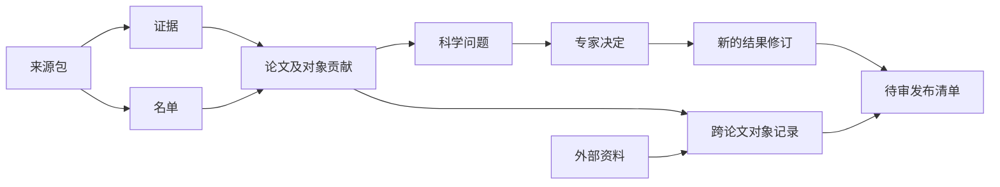

# 数据记录与填写格式

说明各类记录的职责、科学含义，以及提取者填写内容怎样转换为保存记录。字段定义、允许值和英文模板见[生成说明](../../contracts/generated/README.md)；旧格式复用依据和科学例子集中在文末。程序运行与恢复见 [架构设计](architecture.md#保存恢复与版本)，当前实现及验收状态见 [交接](../../.dev/progress.md)。

返回 [设计总览与阅读入口](../design.md)。

字段任务先读 [记录职责](#记录职责) 与受影响结构，再查对应生成模型／模板；只有填写转换、逐量完成或验收任务才补读相应章节。文末 [设计依据与例子](#论文贡献的设计依据与例子) 按科学表达或旧格式核对需要读取，不作为另一套字段定义。

## 记录职责

本文件维护记录职责与设计依据，正式字段和允许取值由共同代码定义生成。“内容哈希”是根据文件内容计算的标识，用于检查内容是否变化。

| 记录 | 负责保存什么 |
|---|---|
| 论文与来源包 | arXiv 标识与具体版本、来源包、原文位置及未处理的材料范围 |
| 论文贡献 | 对象、本篇研究的简短摘要、贡献类型、作者总体判断、各条件下的结论与测量及原文证据 |
| 名单结果 | 对象角色、方法、证据及完成或未决状态 |
| 对象与外部记录 | 稳定身份、别名、关联依据及有出处的外部资料 |
| 裁决 | 问题、决定、理由、操作者和适用的材料与规则版本 |
| 运行清单 | 实际输入、规则、方法、模型、提示、专家裁决配置、代码与依赖版本、案例、结果和用量 |
| 发布清单 | 数据版本、内容哈希、来源运行与代码、修改摘要、批准及各渠道结果 |

论文记录保存该论文的元数据和贡献；对象记录通过引用关联论文测量，避免同一内容在两处分别修改。对象改名不改变稳定身份；合并、拆分及科学更正保留理由和依据。

## 核心记录与填写格式

共同定义位于 [`hvs_catalog.records`](../../src/hvs_catalog/records/__init__.py)。[生成的格式说明](../../contracts/generated/record-format.md)维护字段类型、必填与可空、允许值、跨记录检查及填写展开规则；[产物入口](../../contracts/generated/README.md)列出各类 JSON Schema 和英文步骤模板。下文保留这些结构的科学含义和选择理由，不再逐项维护字段清单。

字段／校验修改按 [生成维护规则](../../CONTRIBUTING.md#科学规则维护) 更新来源和检查，不手改产物；科学含义、职责或关键场景变化时同步修改本文件并审定。当前能力见 [README](../../README.md#当前可用能力)：合成评分入口已交付，正式评分与后续服务／发布仍按计划开展。

下图表示材料、结果与后续使用的关系；引用均固定到具体修订，运行清单记录实际输入及输出。

### 保存形式、版本与共同字段

采用 UTF-8 JSON 作为记录的保存和交换形式，Pydantic 作为格式定义与检查的共同来源。工作空间的 SQLite 保存同一份记录内容及检索所需索引；索引可重建，不能成为另一份独立维护的科学结果。数据库事务、锁和恢复见 [架构设计](architecture.md#工作空间与恢复接口方案)。

外层字段见[记录封装](../../contracts/generated/record-format.md#record-envelope)，引用结构见[共同引用类型](../../contracts/generated/record-format.md#common-reference-types)。技术编号、修订、时间和执行信息由程序维护。修订只增不覆盖；引用固定到准确修订，不按“最新版本”悄悄替换，也不以名称近似代替身份判断。未知格式和未声明字段须报错，不能用默认空列表掩盖必填内容的遗漏。

文件引用固定相对路径和内容哈希，禁止越出声明目录；哈希由程序计算。集合检查目标存在、类型及所属论文，引用保存标识，不递归嵌入记录。单条记录格式正确、集合引用正确和科学内容正确分别验证。

选择独立证据记录而不是在每个字段复制引文，可以共享原文并检查引用；代价是保存和导出时须同时包含对应证据、材料清单及修订。数值字符串、原始名称和原文片段不因读写被换算、四舍五入或改写；便于检索的规范化键单独保存或派生。

### 论文、来源与证据

字段和定位结构见[来源包与证据](../../contracts/generated/record-format.md#source-package-and-evidence)及[论文记录](../../contracts/generated/record-format.md#paperdata)。论文标识固定论文版本，来源引用再固定实际输入资料；不同版本不能混合证据。来源包保存获取依据、原始文件、派生材料及其转换关系，不含模型给出的科学判断。

材料缺口保存原因、原文提及及影响范围。范围已知时明确涉及的对象、物理量或收录/身份判断；未知时不能默认未列出的结果不受影响。不存在的文件不编造哈希或行号。仅影响物理量的已知缺口不波及名单；影响收录或身份的缺口使相应判断保持未完成。

证据定位可以是文本行范围、表格单元格或非文本资料中的数据元素，均须对应指定版本的实际材料。转换表保留回原件的映射，非文本材料按实际记录或字段定位，不伪造文本行号。引文保存原文；非文本元素保存解码后的原始值表达及解码方式，保留文件哈希。

记录格式的合成核对不等于交付所有格式的解析器；实际材料准备按 [支持范围](workflow.md#提取材料的准备) 处理。尚不能验证的定位不得声称核对成功，相应材料保持未处理。单位、参考系、历元和条件可以引用其他证据，不必强行塞入数值所在单元格。

表格定位按受支持的 CSV／ECSV 实际逻辑记录核验，保留原列名、解码后的单元格原表达及回原件的映射。`row_key` 须命中实际行，`row_number` 表示命中该行键后的 1 基序号，不是源文件物理行号。零命中报错，唯一命中可以填 null；多个命中必须补足行键或明确序号，不能默认第一行。显式选行只解决位置选择，不代替同名对象的科学身份判断；对象绑定须有实际身份列或明确原文对应，不使用名字子串、备注或邻行值。

### 名单与对象贡献

字段见[名单](../../contracts/generated/record-format.md#roster)和[论文与对象贡献](../../contracts/generated/record-format.md#paper-and-object-contributions)。名单保存收录、排除或待决结果及其依据、材料检查范围和未列清的对象群。收录条目与本篇贡献一一对应；排除或待决条目不创建伪造的已收录贡献。技术编号由程序分配并在步骤间传递，模型不得另造一套身份。

名单未完成时仍可保存已明确的对象和待决项。原文只给范围而未列清成员时，保存原文范围、证据、已明确成员与未完成原因，不生成缺失成员。完整名单的空结果才可结合材料范围表达“没有符合条件的对象”，技术失败及缺口不能靠空列表表达。

每项贡献保留本篇原始名称、简短研究摘要、贡献类型、作者总体判断、条件判断、数值和证据。外部别名不混入本篇名称。摘要与贡献类型各自有证据，可以共享原文位置；作者在不同条件下的结论分别保留，不由模型按多数投票合成总体结论。同一种物理量可以保存多组结果，没有结果时不创建空测量组。

物理量编码沿用旧格式的 18 个 `legacy_path`，允许值与五种作者状态均从 R03 规则来源生成，见[物理量范围](../../contracts/generated/record-format.md#quantity-scope-18-quantities)和[作者总体判断](../../contracts/generated/record-format.md#authors-overall-assessment-states-s04)。尚不能判断时保留原因及疑问，不增加第六种作者状态。无总体结论的证据与缺口边界、`candidates_found` 的收录关系按 [S03/S04](../science-rules.md#main-rules-in-order) 校验，不能凭状态名称自动收录或代替未完成。

各物理量的完成含义见[逐量完成情况](#各物理量的提取完成情况)。材料查阅完成仍可带数值冲突；展示说明根据数值、相关缺口和未决问题生成，不让模型再填一份可能矛盾的汇总标签。涉及收录或身份的疑问阻止相应贡献被当作已确认结果使用。

### 每组数值的字段

字段、数值形式和证据组件见[测量值](../../contracts/generated/record-format.md#measuredvalue)、[覆盖概率](../../contracts/generated/record-format.md#coveragereport)、[分位点](../../contracts/generated/record-format.md#quantilereport)及[具名误差分量](../../contracts/generated/record-format.md#errorcomponent)。点值、区间、单侧误差、覆盖概率、分位点、具名分量、条件和证据的完整细则由 [S05](../science-rules.md#s05-collect-all-reported-values-within-the-quantity-scope)／[S06](../science-rules.md#s06-check-object-assignments-duplicates-and-conflicting-values) 及其定义维护，不另复制规则正文。

数值按原始字符串保存，角度可保留时分秒形式。提取记录不新增清理值来替换原报表达；可机读派生值按 [星表格式清理](workflow.md#星表格式清理与机器可读导出) 在后续构建阶段生成，评分只使用 [排版等价比较](evaluation.md#排版等价与辅助评分模型)。单位、参考系、历元、坐标约定和用途按原文及上下文记录，未知不猜测；零点校正、样本阈值或其他物理量不能误放为对象结果。条件说明保留已知模型、先验、数据和参考状态；只有上下文确实未给条件时，才说明没有报告额外条件。

保存约束还须明确：单侧误差不补零，同一误差不同时填对称与非对称形式；区间保留端点、包含关系和未知解释，不补统计含义。总误差与具名分量可并存，但总误差须有独立依据及明确说明，程序不计算。每个填写的数字组件均保留原报字符串与直接证据，可以引用多处位置；单位和条件另有上下文依据。

本篇结果与本篇引用的历史结果分别保存来源、条件和作者如何采用、替换或否定它们，不选择推荐值。输入无法可靠拆分时，保留原始证据并提出问题，不能捏造完整数值结构以通过校验。单侧误差、未说明解释的区间及总误差与分量并存，是相对旧校验的调整，不能因旧格式不接受就删去原文数据。

### 对象身份与外部记录

字段见[对象与外部记录](../../contracts/generated/record-format.md#objects-and-external-records)。对象记录维护稳定身份、显示名称、别名、论文贡献及外部资料关联；改名不改变稳定身份。合并、拆分和科学更正保存前后关联、理由和依据，保留历史，不重写各篇论文。

关联记录明确确认、待决或拒绝状态，候选匹配不能作为确认事实。外部原始响应及其内容哈希、查询和版本信息可回查；原值、单位、误差、质量信息和历元按实际返回保存。响应只说明服务返回了什么，身份匹配状态放在关联项中。真实 SIMBAD/Gaia 字段、版本和查询范围仍在 R19 审定，R04 不预选科学字段或调用服务。

### 疑问、决定与处理状态

字段见[问题与决定](../../contracts/generated/record-format.md#questions-and-decisions)，绑定和补丁校验见[跨记录规则](../../contracts/generated/record-format.md#cross-record-rules)。科学疑问可以涉及收录、身份、作者判断、数值冲突、物理量归属和其他解释；技术缺口进入材料或运行错误记录，不要求专家为解析失败作科学决定。

问题固定所涉及的记录修订和项目、证据、材料及规则。指纹按实际固定内容计算，不能只按显示文字生成。决定保存原答复、英文表达、理由、操作者和适用的问题版本；结果补丁是对已声明目标的有类型修改，不能包含可执行命令。补丁按完整最终条目验证字段约束和引用，不逐字段检查暂时状态。实际应用时，程序另存新结果修订，不能凭自由文本自动重写通用规则。

收到答复不等于科学问题已解决：专家答复“仍无法确定”时，问题继续未决。新材料或规则使问题变化后，旧决定不得套用；问题替代与历史保留方式见 [裁决共同接口](review.md#裁决共同接口方案)。模型在纯 AI 实验中的处理保存为该执行的模型判断，不创建专家决定。

| 内容 | 保存位置 | 不能混淆的情况 |
|---|---|---|
| 作者怎么判断 | `paper_boundness.status` | `no_overall_conclusion` 是一种明确科学读法 |
| 材料查阅完成到哪里 | 名单 `coverage`、各量 `quantity_coverage` | 已查完仍可能有冲突；空数值不证明未报告 |
| 还有什么科学问题 | `question`、`decision`、冲突项及关联状态 | 收到答复不等于问题已解决 |
| 程序运行到哪里 | 运行和步骤 `state` | 请求成功不保证提取完整，失败不产生成功空结果 |

### 运行与发布清单

字段见[运行与发布清单](../../contracts/generated/record-format.md#run-and-release-manifests)。运行清单固定实际输入及输出，保存运行和步骤状态、模型判断、用量与错误。执行结束不代表科学提取完成，科学完成程度从结果记录读取。

输入快照保存本次执行所依据的固定输入，范围及复用、恢复规则见 [保存、恢复与版本](architecture.md#保存恢复与版本)，文件归档与完整性要求见 [运行输入](architecture.md#业务事务修订与运行输入)。尚未发送的请求不伪造“实际提示”；每次真实发送另保存请求和响应的文件引用、状态、时间、用量及已知服务请求标识。后续运行不再计算或填报货币费用，兼容边界见 [运行记录要求](architecture.md#保存恢复与版本)。认证引用与敏感值的保存边界见 [空间配置要求](architecture.md#空间初始化与文件保存)。

模拟数据明确标记，不能据此报告真实模型质量或调用费用。评价运行记录 Gold 的隔离与评分输入的就绪门禁见 [提取与评分的集成入口](evaluation.md#提取与评分的集成入口)，提取请求不得包含答案或 Gold 路径。

发布清单固定待发布内容、来源运行、代码版本、修改摘要及目标。内容哈希只覆盖待批准内容和目标，不把批准回执或后来更新的渠道状态纳入自身哈希。批准必须绑定具体清单哈希、目标、批准人和时间；没有批准时明确保留未批准状态。各渠道分别保存结果、回执和错误，一个渠道失败不能把全部渠道写成成功。格式正确不构成发布授权。

### 各物理量的提取完成情况

为每个对象单独记录当前规则范围内 18 种物理量的提取完成情况，使用 `quantity_coverage`，放在对象贡献内，与 `quantities`、`quantity_conflicts` 并列保存。这一记录粒度和位置已获人类专家确认。这里的“检查”指提取者查阅材料、提取该物理量的完成范围。逐项记录能表达“速度附表未处理，但距离已检查完”，并让程序发现某种量的检查声明被遗漏；省略一项不能视为已经完成。

填写时允许一次明确声明所有指定物理量的共同情况，再逐项填写例外，由程序展开成上述 18 项保存记录。共同声明必须由提取者提供，不能因没有返回某种量而默认它已检查完。填写与展开要求见[英文填写要求与生成范围](#英文填写要求与生成范围)。

材料检查状态为 `not_checked`、`partial`、`complete`，分别表示未检查、部分检查、相关材料已检查完。它们只描述材料检查情况。数值冲突和其他科学疑问单独关联，执行异常由程序记录；即使材料已检查完，仍可能存在未解决的科学问题。

| 合成情形 | 已保存数值 | 检查情况与问题 | 可给读者的说明 |
|---|---|---|---|
| 已检查对象的所有相关材料，找到距离 8.0 ± 0.5 kpc，没有影响该量的待决问题 | 保留距离值和证据 | 距离检查 `complete` | 已检查完，有结果 |
| 已检查对象的所有相关材料，没有报告视差，也没有相关缺口或疑问 | 不创建空测量 | 视差检查 `complete` | 已检查完，未报告视差 |
| 正文已有速度，但包内速度附表无法解析 | 保留正文速度 | 速度检查 `partial`，关联附表缺口 | 已有部分结果，尚未提取完整 |
| 距离正文和表格存在未解释的冲突，其他相关材料均已检查完 | 双方数值进入冲突项 | 距离检查 `complete`，关联开放冲突 | 材料已检查完，结果待裁决 |
| 数值提取步骤尚未开始，或调用失败且没有已保存的有效检查结果 | 不创建空测量 | 相应量保持 `not_checked`；程序另记未开始或失败 | 尚无有效检查结果 |

只有在固定材料与规则版本下，相关材料已检查完、没有影响该量的材料缺口或未决问题、且没有报告值时，才可将结果显示为“未报告”。没有正面的原文句子时，通过检查范围记录支持这一结论，不编造引句。模型声明“已检查完”本身不证明提取正确；仍须检查结果、材料范围和证据是否一致。

同一材料缺口可以关联多个物理量；材料清单和缺口正文共享引用，避免每种量重复填写。只有能够确定缺口的影响范围时，才让其他量保留检查完成状态；范围未知时，不能默认未列出的量不受影响。缺口涉及对象收录或身份时，按既有科学边界保持相应判断未完成。

运行中的技术失败不改写已保存且输入版本一致的有效结果，也不能自动补出检查完成声明。作者的五种总体判断由 S04 单独规定；“无总体结论”不用于表示这里的任何处理缺口。

### 英文填写要求与生成范围

提交给模型的结构仅含当前步骤需要填写的内容。正式英文模板分别为[名单提取](../../contracts/generated/templates/roster-extraction.md)、[候选判断](../../contracts/generated/templates/candidate-judgment.md)和[数值提取](../../contracts/generated/templates/quantity-extraction.md)，字段与展开规则见[生成说明](../../contracts/generated/record-format.md#filling-formats-and-expansion-rules)。下面维护填写职责与转换理由；模板的实际提取效果在后续接入时验证。

| 步骤填写格式 | 必须填写 | 程序提供或保存 |
|---|---|---|
| 名单提取 | 条目、原始标识、收录/排除/待决、研究摘要、贡献类型、作者总体及条件判断、证据、范围和缺口 | 固定论文/来源上下文，步骤方法、编号和运行信息 |
| 候选判断 | 程序给定候选的判断及对应科学字段；没有列清的组保持未完成 | 既有候选编号和材料引用；不能擅自增删候选以伪装完成 |
| 数值提取 | 程序指定对象的 `quantities`、`quantity_conflicts`、显式 `coverage` 声明、就地填写的证据及问题；必需列表即使为空也显式填写 | 对象编号、已有名单和来源上下文；展开后的 18 项完成记录、记录版本、调用状态和用量 |

每个对象须明确声明本次请求给定的全部物理量的共同检查范围，再逐项填写例外。例外完整替代该量的声明，不采用多层局部合并。相同情况只填一次，例如“全部检查完正文；速度例外，附表尚未处理”；全部未检查也必须明确声明。程序按固定请求展开逐量记录，拒绝缺少声明、重复或未知例外、未知文件及与已知缺口矛盾的完成声明。影响范围未知时保留未完成，不能依靠省略例外宣布其余量完成。

科学数值按实际形式填写。普通点值填写数值、已有误差、单位、条件、来源及证据；区间、分位数、分量误差等仅在适用时提供。共同定义明确哪些字段省略后可补 `null` 或空列表；这种补齐仅表示该可选字段没有提供内容，不推断未报告、检查完成或科学结论。已报告的单侧误差、零、负数及统计解释均须保留；区间必须有相应端点，所有实际填写的数字都须有原文依据。不得用通用“删掉空字段”的规则绕过某种数值形式的必填要求。

数值证据就地填写位置、原文片段及其支持的数字组件。同一处原文支持数值和误差时只写一次定位；不同位置分别填写，区间覆盖概率及误差分量沿用相同方式。程序校验原文后生成独立证据记录及引用，只合并固定来源版本下内容完全相同的证据，不按语义相似性合并。提取者无需维护 `E1` 等证据键或预先创建持久编号。

冲突仍须提供完整的双方数值和理由。程序可从该显式冲突生成类别固定、目标明确的问题记录，并关联该物理量的完成记录；其他新疑问在 `questions[]` 就地填写给定对象编号、受影响物理量、问题内容与依据。程序分配问题编号，不能自行替专家填写答案、关闭问题或推断影响范围。输入中已存在的缺口和问题使用程序给定的引用；新名单条目按返回结构分配编号，后续步骤使用程序已给定的对象编号。执行失败时保留运行错误与已有有效结果，不构造一份成功的空响应。

实际使用的判例在本次输入中提供固定快照引用（编号、版本、文本文件哈希和审定依据）；`precedent_ref` 指向该快照，不要求 R04 提前实现 R21 的判例管理记录。模型只回传所用的给定编号和简短适用说明。

共同英文说明和各步骤填写要求由[生成器](../../src/hvs_catalog/records/generate.py)维护，输出到上述模板，不在设计文档中复制一份正文。执行状态及管理字段不能因共用类型而泄露为模型必填项。字段、条件约束及展开规则须在生成说明与实际校验中一致；无法仅用 JSON Schema 表达的检查由程序执行，并在[跨记录规则](../../contracts/generated/record-format.md#cross-record-rules)说明。模型服务对可选字段的协议支持在接入时核对，不能未经验证就声称所有严格输出模式均支持此填写形态。

### 合成记录与验收对应

正式测试材料位于 [tests/fixtures/records](../../tests/fixtures/records)，均为明确标记的虚构记录与合成原文，不是 Gold 或真实服务结果。它们用于验证共同定义，不能作为另一份字段规范；本机验收记录和验证证据由 [progress](../../.dev/progress.md) 引用。

| 场景 | 应验证的结果 |
|---|---|
| 后续研究确认束缚，并比较历史速度 | 两种来源数值并存，摘要、类型与总体判断分别回查 |
| 纯区间、零和负数、百分数、分量误差 | 原报形式与所有数字证据完整保存，读回不变，不补中心值或推算概率 |
| 未报告、未检查、材料缺失、科学未决、执行失败 | 分别表达；任何空列表不能单独变成“成功无结果” |
| 同一结果正文与表格冲突 | 双方保存在冲突项；专家仍无法解决时保留未决，其余结果按影响范围继续 |
| 候选排除、范围成员未列清 | 排除有依据；未列清成员不伪造、不记成无对象 |
| 外部查询返回候选匹配 | 外部原始响应可回查，未确认匹配不并入已确认对象身份 |
| 版本未知、引用缺失、对象或论文错配、原文哈希改变 | 结构或集合校验拒绝，不能改为读取“最新”内容 |
| 输入变化后应用旧决定、重复应用决定 | 格式保存问题版本及结果修订并校验绑定关系；操作幂等与恢复见 [保存与恢复规则](architecture.md#锁提交与恢复顺序) |
| 发布清单尚未批准或某渠道失败 | 批准为空或渠道失败明确保存，不输出已发布状态 |
| 简化填写后展开保存 | 非空科学字段、证据及 18 项完成情况还原一致；缺少共同声明或掩盖材料缺口须被拒绝 |

科学表达、字段职责及关键场景需要专家认可，JSON 可解析、引用可回查等设计检查不能替代科学审阅。数据格式修改后，按 [验证要求](../../CONTRIBUTING.md#验证要求) 的实际影响选择检查，覆盖读写、错误拒绝和生成一致性；整关交付另核对 [R04 验收要求](../../.dev/plan.md#r04)。关卡是否通过由 progress 记录。

## 论文贡献的设计依据与例子

以下解释论文贡献的复用依据和科学例子。字段与引用以 [核心记录与填写格式](#核心记录与填写格式) 为准，提取者输出采用 [简化填写要求](#英文填写要求与生成范围)。

### 旧格式核对与复用

旧格式参考版本为 `stella_hvs` 提交 `8421c985ca4acd40414464534053ecf2a9ba5513` 的 `src/stella/lit/hvs_contribution_models.py`、`schema_specs.py`、`docs/data-contract.md` 及相关合成测试。旧仓只作为设计与实现参考，新程序不依赖其路径。下表以实际模型及校验为依据。

沿用旧格式的“论文 → 对象贡献 → 物理量 → 多条数值”层次、本篇原始名称、程序编号、摘要／贡献类型及各自证据、原报字符串与数值上下文。v4 已有区间、覆盖概率／分位点和具名误差分量，现行校验以 S05/S06 为准。

与旧格式不同的设计理由：

- 作者状态依当前 S04；旧 `not_assessed` 的科学核对见 [旧规则变化](extraction.md#旧规则对照与调整)，未完成另记，不增加第六种作者状态。
- 旧对象级 `partial` 须有冲突，且无独立 `quantity_coverage`；新结构还表达材料缺口，并逐对象逐量记录 [完成情况](#各物理量的提取完成情况)。
- 旧冲突只有原因和至少两处证据；新冲突保存双方完整测量，不能当两条已确认结果。其余不受影响的结果继续保留。
- 旧 TeX 行／ECSV 单元格定位保留固定材料及原件映射；非文本元素按 [来源与证据](#论文来源与证据) 保存实际定位，不伪造行号。

### 字段如何分工

沿用“论文 → 对象贡献 → 物理量 → 多条数值”的层次。对象贡献中的科学内容由提取步骤填写，程序提供固定的论文与材料上下文，并生成技术编号。

名单或候选判断步骤填写名称、研究摘要、贡献类型和作者判断；数值步骤填写每组测量及其条件、来源和证据。提取者报告材料范围与科学疑问，程序维护技术编号、版本和实际运行信息。各步骤完整字段见[英文填写要求](#英文填写要求与生成范围)所链接的生成模板。

不要求每条正常结果额外填写规则编号或收录理由。摘要证据、类型证据及数值证据可以共享原文位置，但各字段的支持关系要能分别回查。“本篇论文引用的旧值”的证据仍指向本篇材料，来源标为 `prior_work`；这不表示已经读取被引论文。

### 合成例子：后续观测改变作者判断

以下材料为本节定义的虚构输入，不是真实论文、Gold 或已审定判例。`FIC-PAPER-A` 和 `FIC-A` 都是假标识。将三个英文段落作为完整的简化输入，按 E1–E3 引用；这些编号仅用于本例，未伪造真实文件行号。

| 证据 | 虚构原文 |
|---|---|
| E1 | We selected FIC-A for follow-up spectroscopy because it had previously been identified as a Galactic unbound candidate. |
| E2 | Our new spectrum gives a heliocentric radial velocity of 520 ± 10 km/s for FIC-A. For comparison, Previous Study reported a heliocentric radial velocity of 550 ± 20 km/s. |
| E3 | Based on our new observations and analysis, we conclude that FIC-A is bound to the Milky Way. |

这一输入的对象贡献在科学内容上应完整表达为：

| 项目 | 保存内容 | 依据 |
|---|---|---|
| 论文与对象 | `FIC-PAPER-A` 中的 `FIC-A`；对象标识保留原样 | 固定输入与 E1 |
| 研究摘要 | `Follow-up spectroscopy provides a new heliocentric radial velocity and reassesses the object's Galactic boundness.` | E1、E2、E3 |
| 贡献类型 | `follow_up` | E1 |
| 作者总体判断 | `bound` | E3 |
| 物理量 | `observed_phase_space.radial_velocity` | E2 中明确的 heliocentric radial velocity |
| 第一组结果 | `value="520"`、`error="10"`、`unit="km/s"`、`source="this_paper"`；条件 `New spectrum; heliocentric frame.` | E2，中心值和误差分别关联原始数字片段 |
| 第二组结果 | `value="550"`、`error="20"`、`unit="km/s"`、`source="prior_work"`；条件 `Previous Study result quoted for comparison; heliocentric frame.` | E2，中心值和误差分别关联原始数字片段 |
| 完成情况 | 本例所给材料已检查；其余规定物理量在这份合成输入中未报告 | 完整简化输入的检查记录；不编造“未报告”的原文引句 |

本篇明确因历史非束缚候选身份开展后续研究，因此保留贡献及本篇的 `bound` 判断。两组速度来自不同研究，分别保留；对象记录后续可以引用它们。没有报告历元，不补历元值。这个例子只展示科学内容，尚不构成可提交给正式程序的完整记录。

### 合成变体与已确认的保存要求

在上述例子基础上，分别改变一个条件：

| 变体 | 应能表达的结果 |
|---|---|
| 把第一组速度改为作者明确给出的 95% credible interval：500–540 km/s，未给中心值 | 保存 `range_lower="500"`、`range_upper="540"`、区间类型和原报 95%，每个数字有证据；不填中心值或误差 |
| 本篇另有未能解析的包内附表，原文说明其中还有 FIC-A 的速度观测 | 保存已确认的两组速度和附表缺口，数值检查尚未完成；不能宣称速度已提取完整 |
| 新增表格将 E2 中同一次新观测写成 525 ± 10 km/s，未说明订正或条件差别 | 经核查仍无法解释时，520 ± 10 与 525 ± 10 作为一项冲突保存，引用正文和表格证据并提出专家问题；550 ± 20 的历史结果仍可保留，前提是冲突不影响收录或身份 |

材料缺失或无法解析时，保留已确认结果，并记录未处理材料及其影响范围。数值冲突项保存冲突原因、双方完整的数值、误差、单位、条件及证据，复用普通数值的表达结构，供专家页面、后续修订和检查程序读取。需要校验这些内容属于同一待决结果，且不能当作两条已确认测量使用。以上两项要求由共同定义和转换/集合校验落实，正式合成测试用于检查这些表达及其错误拒绝。
