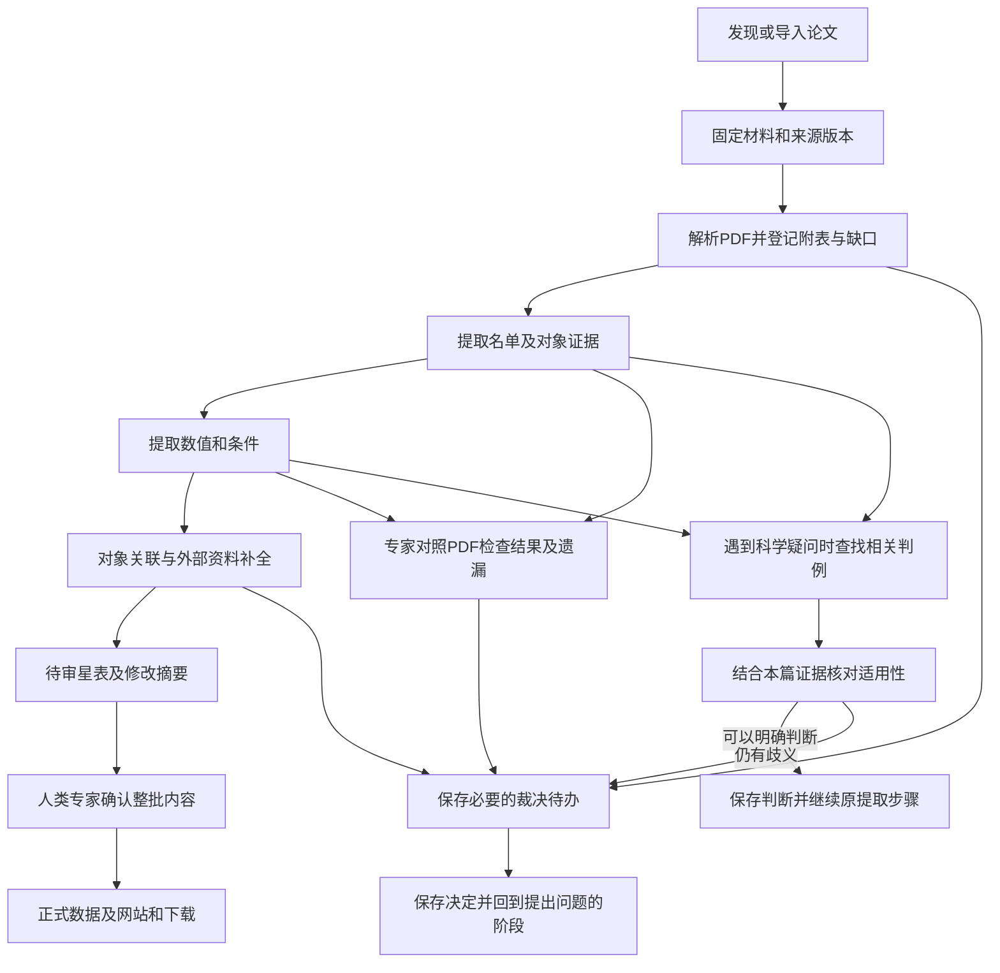

# 文献处理与星表维护

说明从检索、材料准备到对象关联、资料补全和获准发布的用户流程。模块和存储职责见 [架构设计](architecture.md)，格式约束见 [数据记录与填写格式](records.md)。

返回 [设计总览与阅读入口](../design.md)。

## 用户工作过程

官方首版在人类专家本机按需运行。独立安装者处理自己的工作空间、裁决和结果；社区通过 GitHub issue/PR 提议更正，官方入库与发布由人类专家控制。

### 文献检索与材料获取

每轮检索的时间范围、检索词、类别及指定论文由人类专家决定，程序保存实际条件、查询时间、返回结果与处理进度。首版支持专家隔一段时间启动一轮运行，在所选范围内发现论文；是否补查历史文献及运行间隔也由专家决定。

通过 [arXiv API](https://info.arxiv.org/help/api/user-manual.html) 发现论文，默认只下载固定版本的PDF；也支持本地导入期刊PDF，保存论文标识、版本和来源。LaTeX仅在用户手动选择时下载存档，不解包准备提取材料、不参与解析或自动回退；无源码或可选源码下载失败单独报告，不影响已有PDF的提取。首版不扩展通用期刊爬取或多服务聚合。附表按 [科学边界](../design.md#产品目标与科学边界) 单独登记；预印本与期刊版不能混用证据。

首次获取论文时，默认采用当时最新的 arXiv 版本，并固定具体版本号及PDF。后续每轮除检索新论文外，也检查已收录论文是否有新版；旧论文的首次提交日期不在本轮新文献检索范围内，也须检查其修订。已开始的处理继续使用原来固定的版本。

发现新版后，作为同一论文的修订重新处理，比较与旧版的变化，按下述星表维护流程准备修订。不同版本不作为独立论文重复加入星表。旧版材料、提取结果和变化记录均保留；新版获取或处理失败不覆盖旧结果。

版本选择、检查新版和比较修订由系统在提取任务之外完成。每次提取只提供选定版本的材料，不要求提取 AI 选择、下载、合并或管理多个 arXiv 版本。

每轮检查所选检索范围的分页与完成情况。限流、下载失败或未处理完的分页保留进度，不能记成该范围已检索完成。重复命中同一论文与版本时合并检索记录；实际处理仍依据 [固定输入与复用要求](architecture.md#保存恢复与版本) 判断，保留失败和未完成项供后续继续。检索范围改变后，按新范围记录覆盖情况。

获取功能通过 CLI 与 Python 接口使用，提供按条件发现、按标识获取、本地PDF导入、进度查询和恢复；首版不提供获取网页。arXiv本地导入须有明确的标识、版本和来源依据；期刊PDF导入须声明论文键、来源版本和出处，不能从文件名猜定身份；同一标识与版本出现内容冲突时不能静默覆盖。

请求由统一的串行节流入口发送，分页、元数据查询、下载与重试均不能绕过。本机同一用户的多个进程和工作空间共用节流状态；多机器运行仍须操作者协调总请求量，不能宣称本机锁可以协调其他机器。arXiv API 遵守至少三秒请求间隔和单连接要求；PDF与可选源码下载也采用这一保守间隔，不把它表述为官方保证的下载配额。有效的服务端冷却要求优先，临时失败有限重试，拒绝访问时停止而非持续重试；保留进度供恢复。接口和服务规则以开工时的官方文档为依据，参见 [API 使用条款](https://info.arxiv.org/help/api/tou.html) 和 [自动访问说明](https://info.arxiv.org/help/robots.html)。

检索分页完成、新版检查完成和材料获取完成分别记录。服务分页上限、异常空页、截断或中断不能伪装为完整覆盖；必要时提示缩小范围。下载与导入检查PDF类型、大小、加密状态及页面结构，HTML错误页、损坏或加密文件不能作为可用PDF交付；这不代替后续正文和表格解析。

获取阶段遵循 [工作空间串行执行](architecture.md#锁提交与恢复顺序)：发现、下载、导入和修订检查从操作开始到收尾持有空间排他锁，同空间的其他写操作返回忙，不并发推进或自动排队。网络等待不放在长期数据库事务内；不同空间仍共用上述网络节流。状态查询只展示已提交事实。

PDF准入使用成熟库检查完整文件、页数和资源上限。远程收到的限额内原始字节与诊断随空间保留；拒绝的本地文件不导入，调用者原件不变。可选LaTeX存档只保存原始字节及下载来源，不解包、不参与PDF成功判定。

获取状态按串行流程保存：固定版本和材料只有一份权威事实，当前选择是指向它的状态，不再把材料、选择世代、声明事件、历史快照和逐步回执都维护为互相同步的副本。材料与来源历史仍可回查；可从已保存事实派生的视图不再重复持久化。必要的关联修改在短事务内一起提交，已保存的原始包在重试时复用。

新的显式版本选择与既有来源声明复用分开处理：相同包重复导入不改首登来源，新声明须保留依据；显式切换后重复操作不能退回旧选择或混用版本。获取工程状态不要求为每个内部步骤建立独立回执、选择世代或模拟并发的协调机制；重试依据已提交版本、包哈希与进度判断。来源和科学记录的版本、证据引用及提取／裁决的幂等保证不因此改变。冻结最新版前仍须拒绝影响响应可信度的异常，缺失或冲突材料明确报错，不自动补造记录。

获取工程接口采用格式 v2：业务库内一份 `acquisition:state` 保存轮次请求／页引用／下一页位置、当前版本指针、逐版本获取状态和最近修订检查结果；没有独立获取索引。来源记录保存原包引用与首次获取依据，声明记录保存每条本地声明及首登时间；成功材料的路径／哈希、成员清单、来源日志与历史版本不在选择状态重复保存。原包按内容寻址，页文档保留完整解析视图；记录与关联状态在既有短事务接口内一并提交。通用记录提交仍有保存凭据，但获取不靠它重放步骤或协调状态。

Python 的 `get_selection()` / `selected_material()` 查当前选择，`get_version("2401.01234v1")` / `list_versions()` 查各版材料与来源；`SelectionStatus.history` 是其他已登记版本的派生摘要，每版本一项，不是逐次切换历史。CLI `status --json` 分开返回 `selections` 与 `versions`，`status --id` 可带具体版本号回查，不改变选择。旧获取格式拒绝使用，提示新建空间，不自动迁移、重置或删除旧数据；真实材料迁移仍需另行确认。原包已提交后，检查或后续保存中断可从原包继续；发布后尚未提交的文件可能成为未引用附件，重试可能重复请求，不宣称外部请求恰好一次，也不自动清理未知文件。

### 提取材料的准备

#### PDF主流程目标

通过本地MinerU 4的advanced档把固定PDF转换为模型可读文本、表格及原始图片；保存原PDF、解析输出、页面／内容块对应和工具版本。只实现项目需要的调用、保存及失败报告，不自建通用PDF解析器，不同时维护LaTeX主流程或多个自动回退。正文、附录、表格、图注及相关脚注按实际解析范围交付；未提供的附表、缺页和无法可靠解析的内容分别说明。

Markdown及结构化输出用于阅读和定位，原PDF用于证据核对。检查页码与位置是否有效，并用代表样例核对对象行、数值、负号、上下标、误差及单位；文字匹配不能证明转换或科学归属正确。解析错误、材料缺失、科学歧义和原文确实未报告分别记录，能确认的部分保留。普通对象名称和引用键不因含数字或连字符就自动成为编号范围缺口。

模型与专家使用同一份固定PDF。名单提取后再进行数值提取；全自动策略由模型自行解释歧义并完成处理，专家辅助策略允许提交疑问，专家也能查看草稿和原PDF、发现遗漏并修正结果。策略及结果隔离见 [裁决配置](review.md#专家裁决开关)。结果须能回查原PDF；已有材料和结果不自动迁移、重写或删除。

#### 解析、证据与缺口

准备输入是已登记的准确PDF来源修订及哈希，解析全部页面，保留MinerU原始ZIP、Markdown和页面块索引。内容块保存页码、归一化边界框、类型和解析文本；表格HTML与公式原字符串按解析器输出保留，不再次自行解释宏或重建表格。模型材料保留正文、表格和作者图注，移除解析器生成的读图描述，并提供图形及表格的原始图片附件；图片只有位置而没有图注时仍须提供。文字证据绑定原PDF文件及块索引，校验页／块对应和引文，再保存整个来源块供回查；引文只容许空白差异。图片证据保存页码、块编号和模型读到的原文，只验证所引用图片及位置，不能宣称读图内容已经程序核验。

解析器漏页、空页或未声明整篇输出时形成材料缺口；失败保留运行诊断，不能返回成功空材料。准备摘要中的`materials_complete`仅表示没有程序已知的材料缺口，不证明版面、对象行、数字或误差无失真。图内文字不保证进入解析文本；图例、坐标标记及图中对象名须对照原PDF检查。原PDF始终是最终依据。未知影响范围如实保留，明确不受影响的结果继续保存；原文未报告、解析失败和科学解释歧义分别处理。

名单范围的科学处理遵循[提取规则](extraction.md#名单方法和模型选择)：模型理解明确编号范围并逐个提交，保留原范围证据；程序不生成成员，仅核对已列成员与对象条目的一致性。未具名余项保持未完成，成员身份歧义按所选策略处理；一个未列清群体不影响其他明确对象的保存。

材料准备共用工作空间、runtime和事务，提供`materials prepare/status/resume/consume`及对应Python接口。冻结来源、解析代码指纹和工具版本／配置；输入改变建立新执行，同请求同输入复用保存结果。日常与评测使用同一份准备结果，接口不接收Gold。具体资源安装、支持范围和错误处理见 [准备操作](../operations.md#材料准备正文与表格)。

### 跨论文对象关联

本篇提取完成后，由确定性程序读取已经提取并确认的对象标识、原文对应关系和已保存的裁决决定，按本节条件执行关联。程序无法确认或发现相反证据时，保存候选关系交专家判断；专家决定保存后，程序据此继续执行。这里的条件用于实现和检查关联程序，文献提取规则不负责执行这一阶段。

同一目录、同一版本的明确对象标识一致，或论文明确给出跨论文的同一对象对应关系，且没有相反证据时，可以自动关联。仅坐标接近、名称相似或别名关系含糊时，保存候选关联交专家确认；存在相反证据时也交专家处理。

关联保留标识或原文等依据，各篇论文的原始记录和证据分别保存。不同目录版本中的相同编号不满足上述标识一致条件；未确定的候选关联保持未决。

### 外部资料补全

首版在论文提取完成后，由确定性程序通过 Astroquery 查询以下来源，并按审定的字段和保存要求处理返回资料：

| 来源 | 补充范围 |
|---|---|
| SIMBAD | 对象标识、别名及相关文献链接 |
| Gaia Archive | 星表报告的位置、视差、自行、径向速度，以及相应误差和质量信息 |

保存查询条件、返回条目、来源、可取得的目录版本和查询时间；身份匹配确认后，将外部记录与论文记录并列关联到对象，保留匹配依据。匹配不确定时保留候选关联和待决状态。外部资料独立保存，论文原始记录和科学结论继续以本篇材料为依据。

接口参考 [Astroquery SIMBAD 文档](https://astroquery.readthedocs.io/en/latest/simbad/simbad.html) 与 [Astroquery Gaia 文档](https://astroquery.readthedocs.io/en/latest/gaia/gaia.html)。具体目录版本、字段映射和查询范围在相应功能实施前核定，真实服务调用按 [操作授权](../../CONTRIBUTING.md#开发工作约定) 执行。

### 星表格式清理与机器可读导出

论文提取保留原报数值、误差、单位及证据；面向网站和下载的格式清理放在星表构建阶段。原始记录与可机读派生值分开保存，派生值引用固定的原记录、转换规则及版本，不覆盖原报内容。清理范围包括数值、误差、区间端点与单位的排版语法，不只处理单位；保留原报精度、误差形式、条件和表示方式，不改单位尺度、不作物理或统计推导。具体派生字段及导出格式在实现前审定。

常见形式由确定性程序批量处理，评分与导出复用已审定的基础解析规则，但分别承担 [比较](evaluation.md#排版等价与辅助评分模型) 和生成派生值的职责。例如 LaTeX 的科学计数法可解析成可机读指数表达，单位宏可解析成可机读单位；网站显示可读形式，下载同时提供原报表达与对应派生字段。无法可靠解析的项明确标记，不猜测或伪造一个可用数字。

难以解析的表达可交给已验证的清理 Agent 提出派生值、原文依据及所用解释，经过专家审核后才用于星表候选；规则明确的普通结果不要求逐项人工审核。固定模型输入输出与获准解释，程序检查关键组件、引用及转换边界，再据此生成候选。相同固定输入（含已审定解释）应生成相同结果，不能每次构建重新询问模型并静默改值。模型失败或专家不能确认时保留未处理状态，不能把未验证输出宣称为机器可用数据。

经专家确认的新形式，在明确适用范围并补齐正确、错误和歧义样例后，由主 Agent 将其纳入程序规则并完成工程验证，交人类专家验收后复用；独立技术审核按 [开发方式](../../.dev/plan.md#开发方式与独立审核) 仅在明确要求时安排。个案解释、通用规则和正式发布分别由人类专家审定或批准，不能把模型的一次正确输出当作通用转换代码的正确性证明。清理 Agent 的验证要求参照评分辅助模型的正反例与稳定性检查，但必须检验实际生成派生值的行为，不能用比较能力替代生成能力的验证。调用模型及正式保存仍需相应授权。

### 单轮处理与星表维护

上图展示默认启用专家裁决的流程，运行配置见 [专家裁决开关](review.md#专家裁决开关)。常规处理尽可能自动完成。保存尚未解决的问题后，可以继续处理不受该问题影响的其他论文；程序重启后仍能找到问题、证据和已有决定。本地裁决网页用于处理运行中的问题，静态星表网页用于浏览正式记录。某次运行中的裁决，不自动改变通用科学规则。

首版本地裁决服务默认只允许从本机访问，暂不提供多用户后台。关闭浏览器后任务仍然保留，也能从命令行（CLI）继续处理。

静态星表网站计划提供面向新用户的“项目与数据指南”，解释 AI 如何从文献提取数据、设计原则如何影响结果，以及如何理解和使用星表。指南与来源记录、字段说明和下载入口相互连接，随网站获准发布；内容归属及维护要求见 [文档维护规范](../../CONTRIBUTING.md#文档维护与防止漂移)。

每轮运行在已有星表上整理新贡献，生成下一版待审星表和修改摘要，经专家确认后纳入正式星表。重复运行或检索时间重叠时，同一贡献不重复加入；未完成的论文和裁决继续保留。已有星表也支持修订记录：保留未受影响的记录，列明新增、修订及受影响的对象，修订前后内容和原有依据均可回查。

发布前，先准备具体的待发布内容及修改摘要，请人类专家确认这些内容和发布目标，再按批准范围提交、推送并更新网站和下载。首次公开与日常批次发布分别取得相应授权。开发期间的 Git 操作遵循 [维护规范](../../CONTRIBUTING.md)，正式发布的详细流程在相应功能完成时补充。
