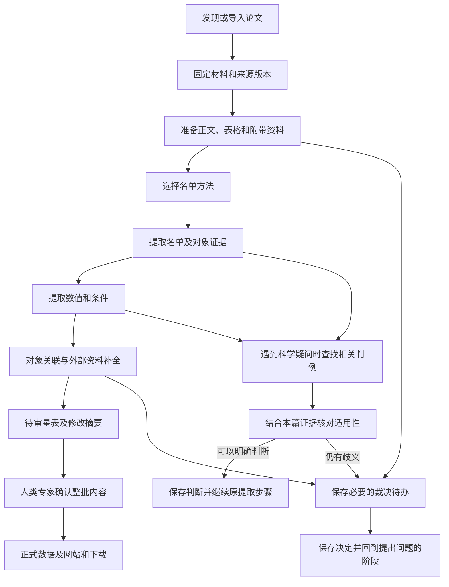

# 文献处理与星表维护

说明从检索、材料准备到对象关联、资料补全和获准发布的用户流程。模块和存储职责见 [架构设计](architecture.md)，格式约束见 [数据记录与填写格式](records.md)。

返回 [设计总览与阅读入口](../design.md)。

## 用户工作过程

官方首版在人类专家本机按需运行。独立安装者处理自己的工作空间、裁决和结果；社区通过 GitHub issue/PR 提议更正，官方入库与发布由人类专家控制。

### 文献检索与材料获取

每轮检索的时间范围、检索词、类别及指定论文由人类专家决定，程序保存实际条件、查询时间、返回结果与处理进度。首版支持专家隔一段时间启动一轮运行，在所选范围内发现论文；是否补查历史文献及运行间隔也由专家决定。

文献发现与获取仅使用 arXiv 服务：通过 [arXiv API](https://info.arxiv.org/help/api/user-manual.html) 检索和读取元数据，再从 arXiv 的 [源码下载入口](https://info.arxiv.org/help/view.html#other-formats) 获取具体版本的 LaTeX 资料包。文献处理不依赖 DeepXiv 或 ADS/SciX；后者的 bibcode、期刊卷页等书目补全不属于首版获取功能，也不作为材料可用的前提。也可导入已下载的同类源码包，保留其 arXiv 标识、版本和来源。已有期刊引用或 DOI 可保存为元数据，提取依据仍为固定的 arXiv 版本。包内附带资料的范围见 [科学边界](../design.md#产品目标与科学边界)，arXiv 的 [附带文件说明](https://info.arxiv.org/help/ancillary_files.html) 说明这些文件随具体论文版本保存。

首次获取论文时，默认采用当时最新的 arXiv 版本，并固定具体版本号及源码包。后续每轮除检索新论文外，也检查已收录论文是否有新版；旧论文的首次提交日期不在本轮新文献检索范围内，也须检查其修订。已开始的处理继续使用原来固定的版本。

发现新版后，作为同一论文的修订重新处理，比较与旧版的变化，按下述星表维护流程准备修订。不同版本不作为独立论文重复加入星表。旧版材料、提取结果和变化记录均保留；新版获取或处理失败不覆盖旧结果。

版本选择、检查新版和比较修订由系统在提取任务之外完成。每次提取只提供选定版本的材料，不要求提取 AI 选择、下载、合并或管理多个 arXiv 版本。

每轮检查所选检索范围的分页与完成情况。限流、下载失败或未处理完的分页保留进度，不能记成该范围已检索完成。重复命中同一论文与版本时合并检索记录；实际处理仍依据 [固定输入与复用要求](architecture.md#保存恢复与版本) 判断，保留失败和未完成项供后续继续。检索范围改变后，按新范围记录覆盖情况。

获取功能通过 CLI 与 Python 接口使用，提供按条件发现、按标识获取、同类本地源码包导入、进度查询和恢复；首版不提供获取网页。本地导入须有明确的 arXiv 标识、版本和来源依据，不能从文件名猜定身份；同一标识与版本出现内容冲突时不能静默覆盖。

请求由统一的串行节流入口发送，分页、元数据查询、下载与重试均不能绕过。本机同一用户的多个进程和工作空间共用节流状态；多机器运行仍须操作者协调总请求量，不能宣称本机锁可以协调其他机器。arXiv API 遵守至少三秒请求间隔和单连接要求；源码下载也采用这一保守间隔，不把它表述为官方保证的下载配额。有效的服务端冷却要求优先，临时失败有限重试，拒绝访问时停止而非持续重试；保留进度供恢复。接口和服务规则以开工时的官方文档为依据，参见 [API 使用条款](https://info.arxiv.org/help/api/tou.html) 和 [自动访问说明](https://info.arxiv.org/help/robots.html)。

检索分页完成、新版检查完成和材料获取完成分别记录。服务分页上限、异常空页、截断或中断不能伪装为完整覆盖；必要时提示缩小范围。下载与导入检查材料类型、大小及归档安全，HTML 错误页、PDF-only 或不安全包不能作为可用 LaTeX 包交付；这不代替后续正文和表格解析。

获取阶段遵循 [工作空间串行执行](architecture.md#锁提交与恢复顺序)：发现、下载、导入和修订检查从操作开始到收尾持有空间排他锁，同空间的其他写操作返回忙，不并发推进或自动排队。网络等待不放在长期数据库事务内；不同空间仍共用上述网络节流。状态查询只展示已提交事实。

首版归档处理面向常规 tar、gzip 封装 tar 和单个 TeX／gzip TeX，复用成熟库，不自行实现通用 tar 兼容解析器。扩展头只接受明确支持、能在解析前限制资源的子集；特殊布局或不能可靠检查的变体明确报告“不支持”，不标为可用源码。远程获取已收到的尺寸限额内原始材料与诊断保存在工作空间并纳入备份；本地导入则可在发布前明确拒绝，保持调用者原文件不变，不要求将被拒绝文件复制到工作空间，提示须说明未导入、未纳入空间备份。实现须在使用说明列出实际支持和拒绝的扩展形态，并以合成包验证；不能以全面拒绝常规包替代检查，也不能将成熟库默认行为当作资源限制保证。具体材料清单不包含正文或表格解析。

获取状态按串行流程保存：固定版本和材料只有一份权威事实，当前选择是指向它的状态，不再把材料、选择世代、声明事件、历史快照和逐步回执都维护为互相同步的副本。材料与来源历史仍可回查；可从已保存事实派生的视图不再重复持久化。必要的关联修改在短事务内一起提交，已保存的原始包在重试时复用。

新的显式版本选择与既有来源声明复用分开处理：相同包重复导入不改首登来源，新声明须保留依据；显式切换后重复操作不能退回旧选择或混用版本。获取工程状态不要求为每个内部步骤建立独立回执、选择世代或模拟并发的协调机制；重试依据已提交版本、包哈希与进度判断。来源和科学记录的版本、证据引用及提取／裁决的幂等保证不因此改变。冻结最新版前仍须拒绝影响响应可信度的异常，缺失或冲突材料明确报错，不自动补造记录。

获取工程接口采用格式 v2：业务库内一份 `acquisition:state` 保存轮次请求／页引用／下一页位置、当前版本指针、逐版本获取状态和最近修订检查结果；没有独立获取索引。来源记录保存原包引用与首次获取依据，声明记录保存每条本地声明及首登时间；成功材料的路径／哈希、成员清单、来源日志与历史版本不在选择状态重复保存。原包按内容寻址，页文档保留完整解析视图；记录与关联状态在既有短事务接口内一并提交。通用记录提交仍有保存凭据，但获取不靠它重放步骤或协调状态。

Python 的 `get_selection()` / `selected_material()` 查当前选择，`get_version("2401.01234v1")` / `list_versions()` 查各版材料与来源；`SelectionStatus.history` 是其他已登记版本的派生摘要，每版本一项，不是逐次切换历史。CLI `status --json` 分开返回 `selections` 与 `versions`，`status --id` 可带具体版本号回查，不改变选择。旧获取格式拒绝使用，提示新建空间，不自动迁移、重置或删除旧数据；真实材料迁移仍需另行确认。原包已提交后，检查或后续保存中断可从原包继续；发布后尚未提交的文件可能成为未引用附件，重试可能重复请求，不宣称外部请求恰好一次，也不自动清理未知文件。

### 提取材料的准备

程序在提取前读取选定的源码包，整理正文、表格及包内附带数据，保留原始文件和位置对应。将表格转换成便于程序读取的格式时，保留标题、表头、单位、注释、对象行及证据位置，使提取 AI 能结合原文理解数值。转换后的内容是同一来源的另一种呈现，不能计为新增科学结果；与原文不一致时以原文为依据，并记录解析问题供修复。转换、解析和修复属于材料准备，提取 AI 负责核对所读内容与原文并报告问题。

“星 1–5”等编号范围由确定性程序在含义明确、能够正确解析时展开，并保留原写法、出处和展开结果的对应关系，供提取 AI 核对。程序不支持的写法保留原文和未列清的范围，留待修复；缺少材料时保持未完成；原文含义本身有歧义时交专家判断。不能让模型猜补成员，也不能把解析失败当成没有对象。

程序记录材料获取与解析的完成情况，把已知缺口随材料一起交给提取 AI。AI 报告提取中发现的问题和受影响的内容；系统汇总技术失败与未完成状态，安排后续处理。可确认的部分继续保留，依赖缺失材料的结果不能记成已经完成。

#### 正文组织与支持格式

材料准备输入为获取阶段已保存的准确来源修订与原包哈希，不重新下载或混用版本。沿用获取阶段的包检查和资源边界，安全展开实际普通成员，保留原始包、文件字节哈希和派生关系；准备结果另存来源包修订，不覆盖旧修订。多个有效主稿要求操作者明确选择，不按名称猜。程序跟随可确定的 `\input`／`\include` 字面路径，组织主稿可达正文与附录，保存包含位置和原文件行号，不任意串联所有 TeX 文件。去注释仍保持行位置，保护 verbatim，不总结或重写正文。缺件、循环、越界、动态或不支持的包含形式分别记录；无关草稿不使有效主稿整体失败，未引用附件也不能因此判为科学无关。

首轮解析常用 `tabular/tabular*`、`longtable`、`deluxetable/deluxetable*`，以及包内 CSV、ECSV、JSON 和可定位的普通文本。保留支持包内宏与引文上下文所需的 `.sty/.cls/.bib/.bbl`，不获取引用论文。FITS、自定义 DAT、图片／PDF 表格及其他未支持格式保留材料、原文提及与未处理范围，不做 OCR 或 PDF 提取。CSV 按支持格式的固定默认值或明确声明读取，不按内容猜分隔符。编码不使用替换字符静默修补；明确编码经受支持的解码方式转换为保留行数的 UTF-8 派生文本，保存原字节、编码与映射，不能确定时保持未处理。

#### 表格转换与原件对应

LaTeXML 主导普通 TeX 表转换，ECSV 用于保存和精确读取转换结果；包内 CSV／ECSV 附表直接读取。`pgfplotstable` backing CSV 只在路径、赋值时刻、选列与显示表头可证明时直读，按作者声明或 PGF 默认空白分隔读取，不按后缀或内容猜分隔符。无法解释的过滤或变换保留缺口，不把完整 backing 文件当成实际呈现表。每种路径遵循相同完整性与证据要求，不要求模型先判断哪些表值得转换。

将已选主稿及实际包内依赖放入只读输入目录，在沙箱内做一次完整作者上下文 LaTeXML 转换；分组、条件、默认参数和包含时刻由成熟转换器处理，不再摘表重建宏状态或硬编码替换作者定义。随程序发行的最小可信观测绑定仅读取原生来源定位，不改变作者宏；包内绑定不得加载。执行出的每次表出现单独登记，以原生来源位置与准确原块对应，无 label、同一行多表和重复包含不能靠表序、词集合或首表猜配；无法证明时保留原件、诊断和缺口。

完整转换后仍按表隔离失败，联合核对进程与转换诊断、错误节点、原表身份、完整行列和跨度；不丢空单元格、补缺格或截断合并格。明确的字面原表可逐行逐格核对原字符串及数值配对；复杂作者宏不自写解释器认证。全稿存在未解决的上下文问题时保存完整性缺口，不能因某张表可读取而抹去。LaTeXML 不可用时，内部读取只接受可证明对应的字面结构，可选 Pandoc 仅在该字面核对通过后尝试渲染；这些回退不能把已经发现的上下文错误或未知对象洗成成功。退出码为零、产生 XML/HTML 或发现数据行都不是充分依据。

转换表以字符串保留原表达，保存中性机器列名（如 `col_001`）、原始多层表头、显示列名、标题、单位、脚注、对象行及合并格结构，不自动赋予物理量含义。CSV／ECSV 按实际逻辑记录读取，处理 YAML、引号和多行，不以物理行或空白拆分代替记录。数值类型推断不替代原值；呈现清洗不抹去缺失标记或有效位数。轻量转换附件保存原文件／表块、输出行列、编码和呈现差异，不增加独立科学业务记录。

最低映射粒度为原表块范围，能够确定原行／单元格时再细化；复杂宏生成的内容不伪造精确 TeX 行号，标明映射粒度与尚不能核验的部分。转换单元格和原表证据组合使用，不能只用 ECSV 的可读性认证科学归属。对象行按实际身份列或明确原表对应定位，不以子串、备注中的名字或邻行值建立身份；重复行键不得默取首行，定位约定见 [来源与证据](records.md#论文来源与证据)。这里只准备同篇材料，不执行跨论文关联或对象收录判断。

#### 缺口、入口与保存

编号范围只在对象编号语境、前缀与端点含义明确时有界展开，保留前导零、原写法、出处、规则和各成员；物理量区间及坐标符号不参与展开。技术上不支持的写法保留未列清范围；完整转换显示的宏生成范围若不能证明原文字面跨度，也须记录实际显示记法与缺口，不能因扫描定义体被掩蔽而静默遗漏。原文含义有歧义时通过 R05 共同裁决接口建立问题。缺口影响能够确认时局部标记，影响未知时如实保存 unknown；明确不受影响的结果继续保留，依赖缺口的判断保持未完成，不产生成功空名单或科学排除。

材料准备提供共享 Python 准备／读取／查询／恢复入口和相应 `materials prepare/status/resume/consume` CLI，复用工作空间、runtime、事务与裁决接口，不另建材料数据库或任务引擎。固定来源修订、主稿／格式选项、解析代码与依赖、实际转换器版本；改变输入建立新执行，同请求重放复用已保存结果，有效决定只应用一次。日常与评测消费同一份正文、表格、映射、编号展开和缺口；准备接口不接收 Gold。尚未实现真实提取时以无模型的合成消费者验证输入传递，不把真实材料接入 mock 冒充真实方法。

### 跨论文对象关联

本篇提取完成后，由确定性程序读取已经提取并确认的对象标识、原文对应关系和已保存的裁决决定，按本节条件执行关联。程序无法确认或发现相反证据时，保存候选关系交专家判断；专家决定保存后，程序据此继续执行。这里的条件用于实现和检查关联程序，文献提取规则不负责执行这一阶段。

同一目录、同一版本的明确对象标识一致，或论文明确给出跨论文的同一对象对应关系，且没有相反证据时，可以自动关联。仅坐标接近、名称相似或别名关系含糊时，保存候选关联交专家确认；存在相反证据时也交专家处理。

关联保留标识或原文等依据，各篇论文的原始记录和证据分别保存。不同目录版本中的相同编号不满足上述标识一致条件；未确定的候选关联保持未决。

### 外部资料补全

首版在论文提取完成后，由确定性程序通过 Astroquery 查询以下来源，并按审定的字段和保存要求处理返回资料：

| 来源 | 补充范围 |
|---|---|
| SIMBAD | 对象标识、别名及相关文献链接 |
| Gaia Archive | 星表报告的位置、视差、自行、径向速度，以及相应误差和质量信息 |

保存查询条件、返回条目、来源、可取得的目录版本和查询时间；身份匹配确认后，将外部记录与论文记录并列关联到对象，保留匹配依据。匹配不确定时保留候选关联和待决状态。外部资料独立保存，论文原始记录和科学结论继续以本篇材料为依据。

接口参考 [Astroquery SIMBAD 文档](https://astroquery.readthedocs.io/en/latest/simbad/simbad.html) 与 [Astroquery Gaia 文档](https://astroquery.readthedocs.io/en/latest/gaia/gaia.html)。具体目录版本、字段映射和查询范围在相应功能实施前核定，真实服务调用按 [操作授权](../../CONTRIBUTING.md#开发工作约定) 执行。

### 星表格式清理与机器可读导出

论文提取保留原报数值、误差、单位及证据；面向网站和下载的格式清理放在星表构建阶段。原始记录与可机读派生值分开保存，派生值引用固定的原记录、转换规则及版本，不覆盖原报内容。清理范围包括数值、误差、区间端点与单位的排版语法，不只处理单位；保留原报精度、误差形式、条件和表示方式，不改单位尺度、不作物理或统计推导。具体派生字段及导出格式在实现前审定。

常见形式由确定性程序批量处理，评分与导出复用已审定的基础解析规则，但分别承担 [比较](evaluation.md#排版等价与辅助评分模型) 和生成派生值的职责。例如 LaTeX 的科学计数法可解析成可机读指数表达，单位宏可解析成可机读单位；网站显示可读形式，下载同时提供原报表达与对应派生字段。无法可靠解析的项明确标记，不猜测或伪造一个可用数字。

难以解析的表达可交给已验证的清理 Agent 提出派生值、原文依据及所用解释，经过专家审核后才用于星表候选；规则明确的普通结果不要求逐项人工审核。固定模型输入输出与获准解释，程序检查关键组件、引用及转换边界，再据此生成候选。相同固定输入（含已审定解释）应生成相同结果，不能每次构建重新询问模型并静默改值。模型失败或专家不能确认时保留未处理状态，不能把未验证输出宣称为机器可用数据。

经专家确认的新形式，在明确适用范围并补齐正确、错误和歧义样例后，由主 Agent 将其纳入程序规则并完成工程验证，交人类专家验收后复用；独立技术审核按 [开发方式](../../.dev/plan.md#开发方式与独立审核) 仅在明确要求时安排。个案解释、通用规则和正式发布分别由人类专家审定或批准，不能把模型的一次正确输出当作通用转换代码的正确性证明。清理 Agent 的验证要求参照评分辅助模型的正反例与稳定性检查，但必须检验实际生成派生值的行为，不能用比较能力替代生成能力的验证。调用模型及正式保存仍需相应授权。

### 单轮处理与星表维护

上图展示默认启用专家裁决的流程，运行配置见 [专家裁决开关](review.md#专家裁决开关)。常规处理尽可能自动完成。保存尚未解决的问题后，可以继续处理不受该问题影响的其他论文；程序重启后仍能找到问题、证据和已有决定。本地裁决网页用于处理运行中的问题，静态星表网页用于浏览正式记录。某次运行中的裁决，不自动改变通用科学规则。

首版本地裁决服务默认只允许从本机访问，暂不提供多用户后台。关闭浏览器后任务仍然保留，也能从命令行（CLI）继续处理。

静态星表网站计划提供面向新用户的“项目与数据指南”，解释 AI 如何从文献提取数据、设计原则如何影响结果，以及如何理解和使用星表。指南与来源记录、字段说明和下载入口相互连接，随网站获准发布；内容归属及维护要求见 [文档维护规范](../../CONTRIBUTING.md#文档维护与防止漂移)。

每轮运行在已有星表上整理新贡献，生成下一版待审星表和修改摘要，经专家确认后纳入正式星表。重复运行或检索时间重叠时，同一贡献不重复加入；未完成的论文和裁决继续保留。已有星表也支持修订记录：保留未受影响的记录，列明新增、修订及受影响的对象，修订前后内容和原有依据均可回查。

发布前，先准备具体的待发布内容及修改摘要，请人类专家确认这些内容和发布目标，再按批准范围提交、推送并更新网站和下载。首次公开与日常批次发布分别取得相应授权。开发期间的 Git 操作遵循 [维护规范](../../CONTRIBUTING.md)，正式发布的详细流程在相应功能完成时补充。
