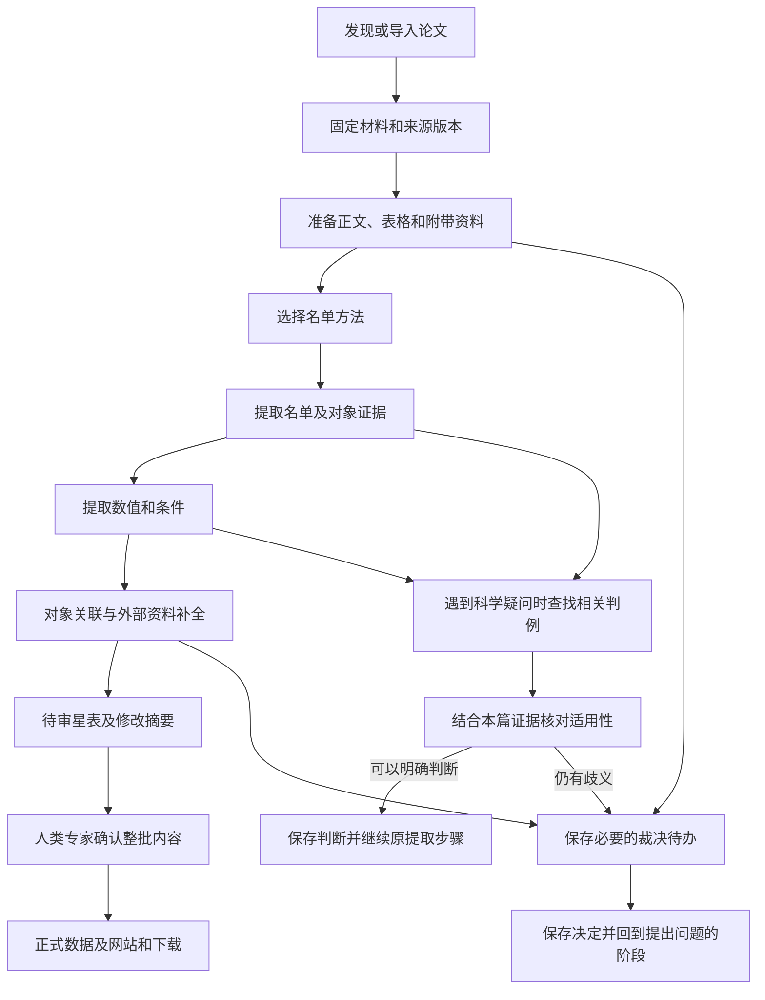

# 文献处理与星表维护

说明从检索、材料准备到对象关联、资料补全和获准发布的用户流程。模块和存储职责见 [架构设计](architecture.md)，格式约束见 [数据记录与填写格式](records.md)。

返回 [设计总览与阅读入口](../design.md)。

## 用户工作过程

官方首版在人类专家本机按需运行。独立安装者处理自己的工作空间、裁决和结果；社区通过 GitHub issue/PR 提议更正，官方入库与发布由人类专家控制。

### 文献检索与材料获取

每轮检索的时间范围、检索词、类别及指定论文由人类专家决定，程序保存实际条件、查询时间、返回结果与处理进度。首版支持专家隔一段时间启动一轮运行，在所选范围内发现论文；是否补查历史文献及运行间隔也由专家决定。

文献发现与获取仅使用 arXiv 服务：通过 [arXiv API](https://info.arxiv.org/help/api/user-manual.html) 检索和读取元数据，再从 arXiv 的 [源码下载入口](https://info.arxiv.org/help/view.html#other-formats) 获取具体版本的 LaTeX 资料包。文献处理无需 DeepXiv。也可导入已下载的同类源码包，保留其 arXiv 标识、版本和来源。已有期刊引用或 DOI 可保存为元数据，提取依据仍为固定的 arXiv 版本。包内附带资料的范围见 [科学边界](../design.md#产品目标与科学边界)，arXiv 的 [附带文件说明](https://info.arxiv.org/help/ancillary_files.html) 说明这些文件随具体论文版本保存。

首次获取论文时，默认采用当时最新的 arXiv 版本，并固定具体版本号及源码包。后续每轮除检索新论文外，也检查已收录论文是否有新版；旧论文的首次提交日期不在本轮新文献检索范围内，也须检查其修订。已开始的处理继续使用原来固定的版本。

发现新版后，作为同一论文的修订重新处理，比较与旧版的变化，按下述星表维护流程准备修订。不同版本不作为独立论文重复加入星表。旧版材料、提取结果和变化记录均保留；新版获取或处理失败不覆盖旧结果。

版本选择、检查新版和比较修订由系统在提取任务之外完成。每次提取只提供选定版本的材料，不要求提取 AI 选择、下载、合并或管理多个 arXiv 版本。

每轮检查所选检索范围的分页与完成情况。限流、下载失败或未处理完的分页保留进度，不能记成该范围已检索完成。重复命中同一论文与版本时合并检索记录；实际处理仍依据 [固定输入与复用要求](architecture.md#保存恢复与版本) 判断，保留失败和未完成项供后续继续。检索范围改变后，按新范围记录覆盖情况。

### 提取材料的准备

程序在提取前读取选定的源码包，整理正文、表格及包内附带数据，保留原始文件和位置对应。将表格转换成便于程序读取的格式时，保留标题、表头、单位、注释、对象行及证据位置，使提取 AI 能结合原文理解数值。转换后的内容是同一来源的另一种呈现，不能计为新增科学结果；与原文不一致时以原文为依据，并记录解析问题供修复。转换、解析和修复属于材料准备，提取 AI 负责核对所读内容与原文并报告问题。

“星 1–5”等编号范围由确定性程序在含义明确、能够正确解析时展开，并保留原写法、出处和展开结果的对应关系，供提取 AI 核对。程序不支持的写法保留原文和未列清的范围，留待修复；缺少材料时保持未完成；原文含义本身有歧义时交专家判断。不能让模型猜补成员，也不能把解析失败当成没有对象。

程序记录材料获取与解析的完成情况，把已知缺口随材料一起交给提取 AI。AI 报告提取中发现的问题和受影响的内容；系统汇总技术失败与未完成状态，安排后续处理。可确认的部分继续保留，依赖缺失材料的结果不能记成已经完成。

### 跨论文对象关联

本篇提取完成后，由确定性程序读取已经提取并确认的对象标识、原文对应关系和已保存的裁决决定，按本节条件执行关联。程序无法确认或发现相反证据时，保存候选关系交专家判断；专家决定保存后，程序据此继续执行。这里的条件用于实现和检查关联程序，文献提取规则不负责执行这一阶段。

同一目录、同一版本的明确对象标识一致，或论文明确给出跨论文的同一对象对应关系，且没有相反证据时，可以自动关联。仅坐标接近、名称相似或别名关系含糊时，保存候选关联交专家确认；存在相反证据时也交专家处理。

关联保留标识或原文等依据，各篇论文的原始记录和证据分别保存。不同目录版本中的相同编号不满足上述标识一致条件；未确定的候选关联保持未决。

### 外部资料补全

首版在论文提取完成后，由确定性程序通过 Astroquery 查询以下来源，并按审定的字段和保存要求处理返回资料：

| 来源 | 补充范围 |
|---|---|
| SIMBAD | 对象标识、别名及相关文献链接 |
| Gaia Archive | 星表报告的位置、视差、自行、径向速度，以及相应误差和质量信息 |

保存查询条件、返回条目、来源、可取得的目录版本和查询时间；身份匹配确认后，将外部记录与论文记录并列关联到对象，保留匹配依据。匹配不确定时保留候选关联和待决状态。外部资料独立保存，论文原始记录和科学结论继续以本篇材料为依据。

接口参考 [Astroquery SIMBAD 文档](https://astroquery.readthedocs.io/en/latest/simbad/simbad.html) 与 [Astroquery Gaia 文档](https://astroquery.readthedocs.io/en/latest/gaia/gaia.html)。具体目录版本、字段映射和查询范围在相应功能实施前核定，真实服务调用按 [操作授权](../../CONTRIBUTING.md#开发工作约定) 执行。

### 单轮处理与星表维护

上图展示默认启用专家裁决的流程，运行配置见 [专家裁决开关](review.md#专家裁决开关)。常规处理尽可能自动完成。保存尚未解决的问题后，可以继续处理不受该问题影响的其他论文；程序重启后仍能找到问题、证据和已有决定。本地裁决网页用于处理运行中的问题，静态星表网页用于浏览正式记录。某次运行中的裁决，不自动改变通用科学规则。

首版本地裁决服务默认只允许从本机访问，暂不提供多用户后台。关闭浏览器后任务仍然保留，也能从命令行（CLI）继续处理。

静态星表网站计划提供面向新用户的“项目与数据指南”，解释 AI 如何从文献提取数据、设计原则如何影响结果，以及如何理解和使用星表。指南与来源记录、字段说明和下载入口相互连接，随网站获准发布；内容归属及维护要求见 [文档维护规范](../../CONTRIBUTING.md#文档维护与防止漂移)。

每轮运行在已有星表上整理新贡献，生成下一版待审星表和修改摘要，经专家确认后纳入正式星表。重复运行或检索时间重叠时，同一贡献不重复加入；未完成的论文和裁决继续保留。已有星表也支持修订记录：保留未受影响的记录，列明新增、修订及受影响的对象，修订前后内容和原有依据均可回查。

发布前，先准备具体的待发布内容及修改摘要，请人类专家确认这些内容和发布目标，再按批准范围提交、推送并更新网站和下载。首次公开与日常批次发布分别取得相应授权。开发期间的 Git 操作遵循 [维护规范](../../CONTRIBUTING.md)，正式发布的详细流程在相应功能完成时补充。
